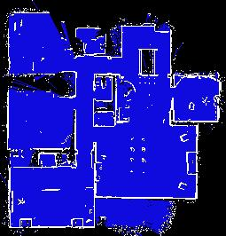

# ecovacs-privacy-control
Privacy first API control for Ecovacs MQTT based vaccums -- tested with Ecovacs Deebot 900/901 series and OZMO 930 _only_

Goal: Control Ecovacs MQTT based vaccum robots directly with a self-hosted local API.

## Technicials

A bunch (all?) of Ecovacs bots do implement do certificate pinning, so they are vulnerable to MITM attacks and establishing your own local MQTT control.

Once setup, MQTT based Ecovacs robot vaccums directly connect to `mq-ww.ecouser.net`:8883 MQTT server. With a proper DNS setup and a self signed cert for `ecouser.net`, users can redirect bot MQTT traffic to a self-hosted MQTT server

ecovacs-privacy-control is a docker container that generates self-signed certificates for `ecouser.net` and launches Mosquitto (MQTT broker). In the future, the goal is to root ecovacs robots and directly communicate with them.

## Usage

- Setup WIFI credentials on robot
  - Hold reset button down robot until you here beep or prompt asking to you go to the app
  - Connect to robot WIFI
  - Send a REST request with `s` as the SSID you want the robot to connect to and `p` being the WIFI password for the SSID
  - `curl -X POST -v \
  http://192.168.0.1:8888/rcp.do \
  -H 'Content-Type: application/json' \
  -H 'User-Agent: Dalvik/2.1.0 (Linux; U; Android 14; Android SDK built for arm64 Build/UE1A.230829.036.A1)' \
  -H 'Connection: Keep-Alive' \
  -H 'Accept-Encoding: gzip' \
  -d '{"td":"SetApConfig","s":"<SSID_HERE>","p":"<PASSWORD_HERE>","u":"ia1a0bodd640d6a2","sc":"b0"}'`
- Build/Run Docker container - Must expose container port 8883
- Point DNS for `ecouser.net` to server running container
- Restart robot -- Robot caches DNS response and to get a refreshed DNS you must restart

If the bot is successful in connecting, you should see something like this in the logs:

```
1637629641: New connection from <snip> on port 8883.
1637629641: New client connected from <snip> as <snip>-<snip>-<snip>-<snip>-<snip>@ls1ok3/<snip> (p2, c1, k120, u'<snip>').
```
## API

`:8000/getMapData` will return the stored map



## TODO:

- Create MQTT Broker with TLS config needed for bot to connect to local server ✅
- Connect robot to WIFI without app ✅
- Document MQTT message schema/contents for sending bot commands ⚠ (WIP)
- Document MQTT message schema/content for receiving bot info ⚠ (WIP)
- Create local API to send/read MQTT messages ⚠ (WIP)
- Gain root access ⚠ (WIP)


### MQTT Communication
Topic Level Variables (Unique per device)
- `$bot_serial` - This is the bots unique serial - format looks something like this `b11fceaf-5173-4190-be6e-9c37ef3dc238`
- `$device_type` - This is the type of bot - format looks something like this `ls1ok3`, `131`, or `Deepo9`
- `$resource` - This is unique to the bot? The format on mine looks like `zwzq`
- `$x` - Any string (for publishing messages for the bot to react to)

Payload XML elements
- `ts` - timestamp
- `td` - functionality

Auto Bot Published - Docked
| Function | Topic | Payload | Notes |
|-|-|-|-|
| Battery Info | `iot/atr/BatteryInfo/$bot_serial/$device_type/$resource/x` | `<ctl ts='1644594388465' td='BatteryInfo'><battery power='100'/></ctl>` | - |
| Charge State | `iot/atr/ChargeState/$bot_serial/$device_type/$resource/x` | `<ctl ts='1644594388466' td='ChargeState'><charge type='SlotCharging' h='' r='' s='' g='0'/></ctl>` | `type` can be `Going`, `SlotCharging`, `WireCharging`, `Idle` |
| Sleep Status | `iot/atr/SleepStatus/$bot_serial/$device_type/$resource/x` | `<ctl ts='1644594398677' td='SleepStatus' st='1'/>` | |

Auto Bot Published - Cleaning
| Function | Topic | Payload | Notes |
|-|-|-|-|
| BigDataCleanInfoReport | | | |
| CleanedMap | | | |
| CleanedMapSet | | | |
| CleanedPos | | | |
| CleanedTrace | | | |
| CleanReport | | | |
| CleanReportServer | | | |
| CleanSt | | | |
| errors | | | |
| MapP | | | |
| MapSt | | | |
| Pos | | | |
| trace | | | |

Back and forth communication with bot
| Function | Publishing Topic | Publishing Payload | Response Topic | Response Payload | Notes |
|-|-|-|-|-|-|
| Get software version | `iot/p2p/GetWKVer/$x/$x/$x/$bot_serial/$device_type/$resource/p/$x/j` | `{}` | `iot/p2p/GetWKVer/$bot_serial/$device_type/$resource/$x/$x/$x/p/$x/j` | `{"ret":"ok","ver":"0.13.0"}` | -|


## Map Decoding Notes

- MapP topic contains an element `p` which contains a base64 encoded string
    - `p` is decoded from base64 into a byte array
    - a ByteArrayInputStream is created off of the resulting byte array
        - The first 5 bytes are placed into a variable called "props"
        - the next 4 are placed into a variable called "length"
        (to be continued)

## Acknowledgements

This work is done on the shoulders of giants. Huge shout out to:
- Bumper: https://github.com/bmartin5692/bumper - Amazing documentation around doing a MITM attack to gain self hosting
- Dennis Giese: https://dontvacuum.me/talks/37c3-2023/37c3-vacuuming-and-mowing.html - Great talk about serial vulnerabilities of ecovacs robots