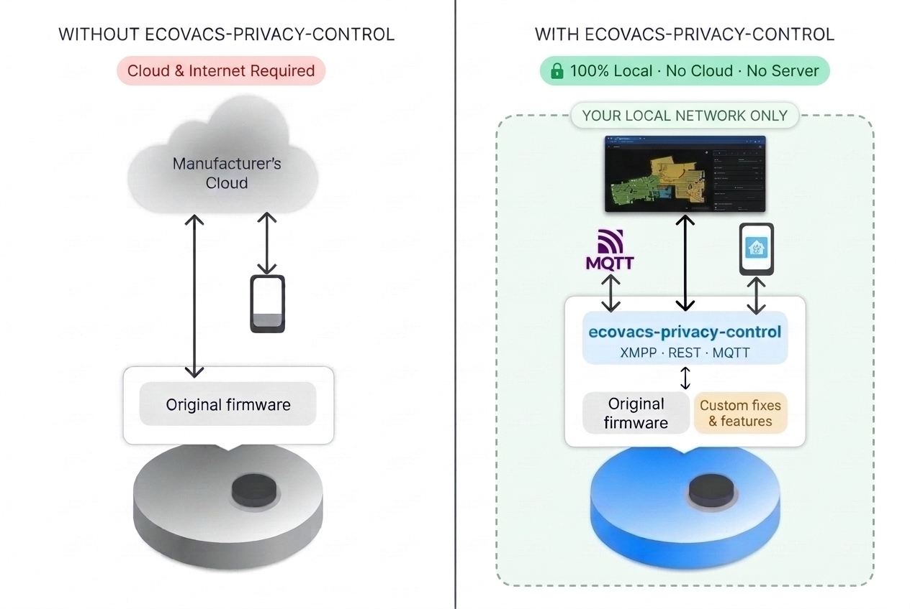

# ecovacs-privacy-control
Privacy first API control for Ecovacs xmpp based vacs -- tested with Ecovacs ~~Deebot 900/901 series and~~ OZMO 930 _only_

Goal: Control Ecovacs MQTT based vaccum robots directly with a self-hosted local API that runs completely on the robot, no external services/server needed.



> [!WARNING]
> There is a lot of AI slop in this repo. Take a backup of your robot's data partition before you start messing with it:
> ```bash
> # Once rooted via Telnet:
> tar -czvf /tmp/data_backup.tar.gz /data
> # Or copy off to a connected USB OTG drive:
> tar -czvf /udisk/data_backup.tar.gz /data
> ```
> I've personally tested most of everything in here with my 930 OZMO, but it's not well reviewed and very much vibe coded.

Everything runs directly on the robot as a single self-contained ARMv7 Go binary (`cmd/ecovacs-bot`), combining the XMPP controller, REST API, Home Assistant MQTT Auto-Discovery bridge, and an embedded MQTT broker — **no external server or cloud connection required**. Home Assistant picks up the vacuum automatically via MQTT Discovery, and map control works with standard Home Assistant camera cards or [lovelace-xiaomi-vacuum-map-card](https://github.com/kushagharahi/lovelace-xiaomi-vacuum-map-card) (see [docs/ha_bridge_integration.md](docs/ha_bridge_integration.md)).

## Root Access & Persistence (OZMO 930)

Persistent root access on the OZMO 930 can be gained without disassembling the robot or soldering UART connections:

1. **Micro-USB OTG Auto-Execution Vulnerability**:
   - The udev rules on the robot trigger `/usr/bin/udisk.sh` whenever a USB storage drive is connected.
   - `/usr/bin/udisk.sh` looks for `/dr930/dr930.sh` on FAT32 USB media and executes it directly as `root` (UID 0).
2. **Automated Exploit Payload (`root_payload/`)**:
   - Format a USB drive as FAT32.
   - Copy `root_payload/autorun.sh` to the root of the USB drive, and copy `root_payload/dr930/dr930.sh` into a `/dr930/` folder on the USB drive.
   - Plug the drive into the micro-USB service port under the top lid and turn the robot on.
   - The payload installs a persistent root telnet daemon into `/data/autostart/00-root-telnet.sh` (which `/etc/rc.sysinit` automatically runs on every boot).
   - Telnet opens immediately on ports `23` and `2323` (passwordless root shell). See [root_payload/README.md](root_payload/README.md) for full details.

---

## Quick Start (OZMO 930)

### 1. Provision WiFi
1. Hold down the reset button under the robot's top cover until it chimes and announces it is in pairing mode.
2. Connect your computer to the robot's AP network (`ECOVACS_xxxx`).
3. Run the provisioning script with your WiFi credentials and `--host-ip 127.0.0.1` so the robot connects to its own local on-bot controller:
   ```bash
   python3 ozmo-930-wifi.py --ssid "<YOUR_SSID>" --passphrase "<YOUR_WIFI_PASSWORD>" --host-ip 127.0.0.1
   ```
4. The robot will join your WiFi network and save the discovery host to `/data/config/medusa/lb.conf`.

### 2. Root the Robot (One-time setup)
1. Prepare a FAT32 USB drive with `root_payload/` as described above.
2. Plug it into the robot's micro-USB port and power-cycle.
3. Verify telnet access: `telnet <ROBOT_IP> 23`.

### 3. Deploy `ecovacs-bot` Directly on the Robot (Zero External Server)
Cross-compile and deploy the unified `ecovacs-bot` binary straight onto the robot:
```bash
python3 robot_patches/deploy_bot.py --build \
  --robot-ip <ROBOT_IP> \
  --robot-sn <ROBOT_SN> \
  --restart \
  --lb-hot-switch
```
Optional flags:
- `--custom-sounds "98:My Sound,99:Another Sound"` — writes `/data/custom_sounds.json` for custom `/data/res/snd/*.ogg` voice prompts.
- `--verify-only` — inspect running processes, listening ports, disk usage, and MD5 without modifying files.

**What this installs on the robot:**
- `/data/ecovacs-bot.gz` (~2.7 MB gzipped; uploaded via `/tmp` RAM staging to stay safe on the 7.7 MiB `/data` partition).
- `/data/autostart/25-ecovacs-bot.sh` — unpacks to `/tmp/ecovacs-bot` and starts on every boot.
- `/data/config/medusa/lb.conf` → `{"lbSvr": "127.0.0.1"}` (and hot-switches the running `medusa` daemon via `mdsctl` without rebooting).
- Self-signed XMPP TLS certs cached in `/data/ecovacs-certs/` (valid through 2099 so the robot's un-synced boot clock never fails TLS validation).

**Ports hosted directly on `<ROBOT_IP>`:**

| Port | Service |
|---|---|
| `:8007` | HTTP discovery lookup server (`medusa` loopback bootstrap) |
| `:5223` | TLS XMPP command & telemetry server (`medusa` loopback) |
| `:8000` | Local REST API (`/health`, `/status`, `/sounds`, `/mapGrid`, commands) |
| `:1883` | Embedded MQTT broker (`mochi-co/mqtt` with 2 MiB map buffers & no-self-echo loop prevention) |

### 4. Connect Home Assistant

Home Assistant's MQTT integration connects to a single broker at a time. Choose whichever setup matches your network:

#### Option A: Bridge to Your Existing LAN Mosquitto Broker (Recommended)
If Home Assistant already uses a Mosquitto broker (e.g. for Zigbee2MQTT) or your robot lives on an isolated IoT VLAN where outbound connections to LAN are blocked, add this bridge block to `mosquitto.conf` and restart Mosquitto. Mosquitto initiates the connection *inbound* to the robot, so your IoT firewall stays completely sealed:

```conf
connection ecovacs-ozmo930
address <ROBOT_IP>:1883
clientid mosquitto-ozmo930-bridge
try_private false
bridge_protocol_version mqttv311
cleansession true
notifications false
bridge_attempt_unsubscribe false
restart_timeout 5

topic homeassistant/# in 0
topic ecovacs/# both 0
```

Because the robot's embedded broker suppresses self-echo, `topic ecovacs/# both 0` works bidirectionally without echo loops and requires no per-entity topic configuration.

#### Option B: Direct to the Robot (Vacuum is your only MQTT device)
Point Home Assistant's MQTT integration directly to `<ROBOT_IP>` on port `1883` (anonymous, no password).

#### Option C: Robot Connects Outbound as a Plain MQTT Client
If your robot is allowed to reach your existing LAN Mosquitto broker directly, disable the embedded broker in `/data/autostart/25-ecovacs-bot.sh` (`-mqtt-listen off -mqtt-broker tcp://<MQTT_BROKER_IP>:1883`, or `MQTT_LISTEN=off` / `MQTT_BROKER=tcp://<MQTT_BROKER_IP>:1883`) — no bridge config needed in `mosquitto.conf`.

Home Assistant will automatically discover:
- `vacuum.ecovacs_deebot_ozmo_930` (State, Clean, Pause, Return to Base, Locate)
- `camera.ecovacs_deebot_ozmo_930_map_data` (Live rendered map with room polygons and active no-go zones)
- Sensors for battery level, charging state, main brush, side brushes, dust filter, and clean stats
- Binary sensor for mopping water tank attachment
- Switches for carpet boost, continuous clean, voice reports, and DND
- Select entities for water flow rate and voice prompt soundboard
- Volume number slider and consumable reset buttons

### 5. Interactive Map Card (Rooms, Zones, Spot, Go-To & No-Go Zones)

Install [lovelace-xiaomi-vacuum-map-card](https://github.com/kushagharahi/lovelace-xiaomi-vacuum-map-card) via HACS (add as a custom Dashboard repository), then add a **Manual** card to your Home Assistant dashboard with the YAML below:

1. Replace `<ROBOT_SN>` in both `internal_variables.topic` and the `Clear No-Go Zones` icon's `service_data.topic` with your robot's serial number (e.g., `ecovacs/<ROBOT_SN>`).
2. Verify `entity` and `map_source.camera` match the auto-discovered entity IDs in your Home Assistant instance.
3. *(Optional)* Customize or remove the `vacuum_clean_zone_predefined` example entry (`Bathroom`) with your own cropped-map pixel coordinates.
4. Save the card and refresh your browser (`Cmd+Shift+R` / `F5`) — no Home Assistant restart is required.

> [!NOTE]
> - **Drawing No-Go Zones**: Select **No-Go Zones** from the mode selector, draw all exclusion rectangles you want (up to `max_selections: 10`), and press Play. Each submit replaces the robot's saved restriction list; active zones are rendered in **red** on the live map camera.
> - **Clearing No-Go Zones**: Tap the **eraser** icon on the card's bottom action bar and confirm to clear all virtual walls and no-go areas.
> - **1:1 Calibration & `* 50` Scaling**: The 1:1 `calibration_points` emit cropped-map pixel coordinates (50 mm/pixel). The `No-Go Zones` template multiplies coordinates by `50` to match the world-mm coordinate space expected by `CombinedVirtualRestrictionsCapability/set`.

```yaml
type: custom:xiaomi-vacuum-map-card
title: Interactive Rooms & Zone Cleaning
entity: vacuum.ecovacs_deebot_ozmo_930
vacuum_platform: Hypfer/Valetudo
map_source:
  camera: camera.ecovacs_deebot_ozmo_930_map_data
calibration_source:
  calibration_points:
    - vacuum:
        x: 0
        'y': 0
      map:
        x: 0
        'y': 0
    - vacuum:
        x: 1000
        'y': 0
      map:
        x: 1000
        'y': 0
    - vacuum:
        x: 0
        'y': 1000
      map:
        x: 0
        'y': 1000
internal_variables:
  topic: ecovacs/<ROBOT_SN>
map_locked: true
two_finger_pan: false
append_icons: true
icons:
  - icon: mdi:eraser
    tooltip: Clear No-Go Zones
    tap_action:
      action: call-service
      service: mqtt.publish
      confirmation:
        text: Clear all no-go zones?
      service_data:
        topic: ecovacs/<ROBOT_SN>/CombinedVirtualRestrictionsCapability/set
        payload: '{"virtual_walls": [], "no_go_areas": []}'
map_modes:
  - template: vacuum_clean_segment
  - template: vacuum_clean_zone_predefined
    predefined_selections:
      # Example predefined zone (replace with pixel coords from your own map)
      - zones:
          - - 23
            - 128
            - 59
            - 166
        label:
          text: Bathroom
          x: 41
          'y': 147
          offset_y: 35
        icon:
          name: mdi:shower
          x: 41
          'y': 147
  - template: vacuum_clean_zone
  - name: Pin & Clean (Spot)
    icon: mdi:target
    selection_type: MANUAL_POINT
    coordinates_rounding: true
    coordinates_to_meters_divider: 100
    repeats_type: NONE
    service_call_schema:
      service: mqtt.publish
      service_data:
        topic: '[[topic]]/SpotCleaningCapability/clean/set'
        payload: '{"coordinates": {"x": [[point_x]], "y": [[point_y]]}}'
  - template: vacuum_goto
  - name: No-Go Zones
    icon: mdi:cancel
    selection_type: MANUAL_RECTANGLE
    max_selections: 10
    coordinates_rounding: true
    coordinates_to_meters_divider: 100
    repeats_type: NONE
    service_call_schema:
      service: mqtt.publish
      evaluate_data_as_template: true
      service_data:
        topic: '[[topic]]/CombinedVirtualRestrictionsCapability/set'
        payload: |-
          {
            "virtual_walls": [],
            "no_go_areas": [
              
              {
                "points": {
                  "pA": {"x": {{ s[0] * 50 }}, "y": {{ s[1] * 50 }}},
                  "pB": {"x": {{ s[2] * 50 }}, "y": {{ s[1] * 50 }}},
                  "pC": {"x": {{ s[2] * 50 }}, "y": {{ s[3] * 50 }}},
                  "pD": {"x": {{ s[0] * 50 }}, "y": {{ s[3] * 50 }}}
                }
              },
              
            ]
          }
```

---

## Custom Firmware Patches & Deployment

Custom shared libraries inject into `medusa` via `LD_PRELOAD` to fix factory firmware quirks and enable quiet point-to-point transit:
- **Map Saver & Anti-Wipe (`libpersistmap.so`)**: Prevents the robot from deleting its own floor map! In factory Ecovacs firmware, if return-to-dock times out or the robot is picked up, it catastrophically purges the active map from memory, resets coordinates to `(0, 0)`, and blindly wanders into walls. This patch traps relocation timeouts, preserves the active map and coordinates, suppresses blind wandering, and enables true map restoration from storage.
- **Silent Drive / Quiet Navigation (`libsilentgoto.so`)**: Allows you to drive the robot to coordinates without the vacuum suction motor screaming. By default, the OZMO 930 hardware unconditionally runs the vacuum suction motor at full blast (11,000–15,000 RPM) during any autonomous navigation. This patch silences the cleaning motors and startup voice lines whenever the robot is executing a "Go to" point-to-point transit command.
- **Direct Global Pathing (`libdirectpath.so`)**: Bypasses synthetic boundary doorway detours in open-concept floor plans with single-pass global A* path planning.
- **SLAM Pose & Drift Guard (`libslamguard.so`)**: Intercepts erroneous pose jumps to prevent SLAM localization crashes and sudden redocking failures.

### Deploying Patches over Telnet

The deployment script ([robot_patches/deploy.py](robot_patches/deploy.py)) transfers patches directly over the root Telnet connection (port 23), verifies remote checksums, and configures persistent boot loading via bind mount (`mount --bind /data/rc.d/medusa.sh /etc/rc.d/medusa.sh`):

```bash
# Deploy all patches from default directory:
python3 robot_patches/deploy.py --robot-ip <ROBOT_IP>

# Deploy only a specific patch (and compile only that patch):
python3 robot_patches/deploy.py libsilentgoto --build --robot-ip <ROBOT_IP>

# Deploy from any custom patch directory:
python3 robot_patches/deploy.py /path/to/my_patch --robot-ip <ROBOT_IP>

# Check which patches are installed and verified on the robot:
python3 robot_patches/deploy.py --robot-ip <ROBOT_IP> --verify-only

# Deploy and apply immediately (restarts medusa without full reboot):
python3 robot_patches/deploy.py --robot-ip <ROBOT_IP> --restart-medusa
```

---

## API

The controller exposes a local REST API on port `8000`:

- `GET :8000/getMapData`: Returns the current SLAM map JSON.
- `GET :8000/map.png`: Returns a rendered 2D floor plan image with robot and dock positions.
- `POST :8000/clean`: Trigger auto cleaning (`{"act":"s"}`).
- `POST :8000/stop` / `POST :8000/pause` / `POST :8000/resume`
- `POST :8000/charge`: Return to charging dock.
- `POST :8000/spot_area`: Clean specific room segment (`{"mid":"0,1"}`).
- `POST :8000/custom_area`: Clean specific coordinate bounding box (`{"p":"x1,y1,x2,y2"}`).
- `POST :8000/goto`: Point-to-point transit to target coordinate (`{"x":100,"y":120}`).
- `POST :8000/play_sound`: Play built-in voice prompt or custom audio file (`{"name":"71"}` or `{"name":"custom_sound"}`).
- `POST :8000/water_flow`: Set electronic mopping water flow rate (`{"level":"low|medium|high|max"}`).

---

## Verified Protocol Rules (Reverse-Engineered from Firmware)

1. **Room (Segment) Cleaning**:
   - XML: `<clean act="s" type="SpotArea" mid="0,1" deep="1"/>`
   - **Mutual Exclusion**: The `p` attribute **must not** be present. If both `mid` and `p` are sent, the robot firmware aborts with `spotArea has mid and p` and rejects the task.
2. **Zone (Custom Area) Cleaning**:
   - XML: `<clean act="s" type="SpotArea" p="x1,y1,x2,y2" deep="1"/>`
   - Must use `type="SpotArea"`. Do **not** use `type="spot"` (which is single-point clean taking only `x,y` and causes navigation failure / redock).
   - The `mid` attribute **must not** be present.
3. **Audio DAC Latency**:
   - The Rockchip RK3188 audio DAC has ~150-250ms power-gate wake-up latency.
   - All custom audio files must be 16kHz mono Vorbis OGG with 350ms lead-in padding (`-af "adelay=350:all=1"`) to prevent initial syllable cutoff.
4. **Motor Control & Silent Navigation**:
   - Cleaning task types (Auto, Spot, Area, Custom Zone) unconditionally spin up the suction motor (11,000 RPM baseline / 15,000 RPM carpet boost).
   - Silent point-to-point transit is achieved using `libsilentgoto.so`.

---

## TODO:

- [x] Create MQTT Broker with TLS config needed for bot to connect to local server
- [x] Connect robot to WiFi without app (`ozmo-930-wifi.py`)
- [x] Document XMPP message schema & commands
- [x] Document XMPP telemetry & status responses
- [x] Create local API to send/read commands and retrieve maps
- [x] Gain persistent root access via USB OTG exploit (`root_payload`)
- [x] Fix map-wiping on relocation failure & provide map recovery (`libpersistmap.so`)
- [x] Drive robot around without suction motor (`libsilentgoto.so`)
- [x] Home Assistant MQTT Auto-Discovery bridge (`pkg/habridge`)
- [x] Dynamic soundboard / custom audio playback support
- [x] Consumable lifespan sensors & mopping water tank detection
- [x] Run controller and HA MQTT bridge directly on the robot itself (zero external server)
- [ ] Fix pause button quirks during certain navigation states
- [ ] Auto-create interactive map rooms/zones in Lovelace
- [x] One-click deployment script for custom firmware patches (`robot_patches/deploy.py`)
- [ ] Integration tests via firmware emulation in QEMU

---

## Technical Overview

### OZMO 930 (DR930 / DG3G / Class 115)
The OZMO 930 runs an embedded Linux system on a Rockchip RK3188+ SoC (ARMv7 Cortex-A9) managed by the internal `medusa` daemon. Unlike older models that communicate over raw MQTT, the OZMO 930 communicates using **XML over TLS XMPP** with an HTTP discovery service:

1. **WiFi Provisioning (TCP :9876)**:
   - When placed in AP mode (`ECOVACS_xxxx`), the robot listens on TCP port 9876.
   - Using `ozmo-930-wifi.py`, you can send WiFi credentials and point the robot's Load Balancer (`lb`) parameter directly to your self-hosted controller IP (`<HOST_IP>`). **No DNS redirection or certificate poisoning is required** when provisioned this way!
2. **HTTP Discovery Server (HTTP :8007)**:
   - On boot, the robot requests `POST http://<HOST_IP>:8007/lookup.do` to locate the message server (`EcoMsgNew`).
   - The controller replies with `{"result":"ok","ip":"<HOST_IP>","port":5223}`.
3. **TLS XMPP Command Channel (TLS :5223)**:
   - The robot connects over TLS to port 5223.
   - Commands (Clean, SpotArea, Charge, Stop, Sound, etc.) and telemetry (battery, charging state, brush lifespans, map updates) are exchanged via XML `<ctl td="..."/>` stanzas inside XMPP `<iq>` stanzas.

### Legacy Deebot 900 / 901 Series
Older models connect to `mq-ww.ecouser.net:8883` over MQTTS. Because they do not enforce certificate pinning, pointing DNS for `ecouser.net` to a local Mosquitto broker running with a self-signed CA allows MITM control. Historical setup documentation and OpenSSL/Mosquitto templates are archived in [docs/legacy_deebot_900_mitm.md](docs/legacy_deebot_900_mitm.md) (and RV1107 firmware images remain in `900_binaries/`).

---

## Acknowledgements

This work is done on the shoulders of giants. Huge shout out to:
- **Bumper**: https://github.com/bmartin5692/bumper - Amazing documentation around doing a MITM attack to gain self hosting.
- **Dennis Giese**: https://dontvacuum.me/talks/37c3-2023/37c3-vacuuming-and-mowing.html - Great talk and research on serial/firmware vulnerabilities of Ecovacs robots.
