# Home Assistant MQTT Bridge Integration Guide: Ecovacs Deebot OZMO 930

The **Home Assistant MQTT Bridge (`ha-bridge`)** runs alongside the Ecovacs privacy controller.

It communicates with your local Mosquitto MQTT broker (`<HOST_IP>:1883`) and publishes Home Assistant MQTT Auto-Discovery definitions, creating a single device with integrated entities while maintaining Valetudo-compatible map and capability MQTT payloads for Lovelace vacuum map cards.

---

## 1. Auto-Discovered Home Assistant Device & Entities

**Device Name:** `Ecovacs Deebot OZMO 930`  
**Model:** `Deebot OZMO 930 (DR930)`  
**Manufacturer:** `Ecovacs`  

| Entity ID | Type | Purpose / Capabilities |
|---|---|---|
| `vacuum.ozmo_930` | Vacuum | Start, Pause, Stop, Return to Base, Locate, state (`docked`, `cleaning`, `returning`, `paused`, `idle`). |
| `camera.ozmo_930_map_data` | Camera | Live map PNG feed with embedded `ValetudoMap` zTXt chunk and room polygon/bounding-box attributes. |
| `sensor.ozmo_930_battery` | Sensor | Battery state of charge (0–100%). |
| `sensor.ozmo_930_brush_lifespan` | Sensor | Main roller brush remaining lifespan percentage. |
| `sensor.ozmo_930_side_brush_lifespan` | Sensor | Dual side brushes remaining lifespan percentage. |
| `sensor.ozmo_930_filter_lifespan` | Sensor | HEPA dustbin filter remaining lifespan percentage. |
| `binary_sensor.ozmo_930_water_box` | Binary Sensor | Detects if the mopping water tank & plate are physically clicked into the vacuum. |
| `select.ozmo_930_water_flow` | Select | Electronic mopping pump flow rate control (`Low`, `Medium`, `High`, `Max`). |
| `select.ozmo_930_soundboard` | Select | Soundboard dropdown with stock and configured custom robot voice prompts. |
| `number.ozmo_930_volume` | Number | Speaker volume slider (0 to 100%, 5% step). |

---

## 2. MQTT Topics & Valetudo-Compatible Map Capabilities

For compatibility with custom vacuum map cards such as `custom:xiaomi-vacuum-map-card` and `custom:valetudo-map-card`, `ha-bridge` publishes state and map data using the `ValetudoMap` v2 schema under the configured primary topic (`MQTT_TOPIC`, defaulting to `valetudo/<DEVICE_ID>/`) and subscribes to control commands under `valetudo/<DEVICE_ID>/` (plus `valetudo/ozmo_930/`):

- **ValetudoMap JSON v2:** `<MQTT_TOPIC>/<DEVICE_ID>/MapData/map_data`
- **PNG Map (with `ValetudoMap` zTXt chunk):** `<MQTT_TOPIC>/<DEVICE_ID>/map_data`
- **Raw Map Image:** `<MQTT_TOPIC>/<DEVICE_ID>/map_image`
- **State & Battery Object:** `<MQTT_TOPIC>/<DEVICE_ID>/state`
- **Command Topic:** `<MQTT_TOPIC>/<DEVICE_ID>/command`
- **Water Flow:** `<MQTT_TOPIC>/<DEVICE_ID>/water_flow` (`set_water_flow`)
- **Speaker Volume:** `<MQTT_TOPIC>/<DEVICE_ID>/volume` (`set_volume`)
- **Play Sound:** `<MQTT_TOPIC>/<DEVICE_ID>/play_sound`
- **Map Capabilities (under `valetudo/<DEVICE_ID>/...`):**
  - `MapSegmentationCapability/clean/set`
  - `ZoneCleaningCapability/start/set`
  - `GoToLocationCapability/target/set` and `GoToLocationCapability/go/set`
  - `SpotCleaningCapability/clean/set`
  - `CombinedVirtualRestrictionsCapability/set`

---

## 3. Lovelace Dashboard Cards

### Option A: Standard Native Lovelace Card (No HACS Required)

```yaml
type: vertical-stack
cards:
  - type: tile
    entity: vacuum.ozmo_930
    features:
      - type: vacuum-commands
        commands:
          - start_pause
          - stop
          - return_home
  - type: picture-entity
    entity: camera.ozmo_930_map_data
    show_state: false
    show_name: true
    name: "OZMO 930 Floor Plan"
  - type: entities
    title: "Mopping & Consumables"
    entities:
      - entity: binary_sensor.ozmo_930_water_box
      - entity: select.ozmo_930_water_flow
      - entity: number.ozmo_930_volume
      - entity: select.ozmo_930_soundboard
      - entity: sensor.ozmo_930_brush_lifespan
      - entity: sensor.ozmo_930_side_brush_lifespan
      - entity: sensor.ozmo_930_filter_lifespan
```

### Option B: Custom Map Card (`custom:valetudo-map-card`)

```yaml
type: custom:valetudo-map-card
vacuum: vacuum.ozmo_930
valetudo_prefix: valetudo
valetudo_identifier: <DEVICE_ID>
title: "Living Room OZMO 930"
show_dock: true
show_path: true
show_camera: true
```

---

## 4. Architecture & Data Flow

In the zero-server on-bot deployment (`cmd/ecovacs-bot`), `ecovacs-controller`, `ha-bridge`, and an embedded MQTT broker (`:1883`) run directly on the robot inside `/tmp/ecovacs-bot` (unpacked from `/data/ecovacs-bot.gz` at boot):

```mermaid
graph LR
    subgraph Robot ["Ecovacs OZMO 930 (<ROBOT_IP>)"]
        FW["medusa Firmware Daemon"]
        Controller["ecovacs-controller (127.0.0.1:8007/5223/8000)"]
        Bridge["ha-bridge (in-process)"]
        BotMQTT["Embedded MQTT Broker (:1883)"]
    end

    subgraph Infrastructure ["Home Network"]
        MQTT["Mosquitto Broker (Bridge to <ROBOT_IP>:1883)"]
        HA["Home Assistant Core"]
    end

    FW <--"Loopback TLS XMPP (127.0.0.1:5223)"--> Controller
    Controller <--"Local HTTP Polling (127.0.0.1:8000)"--> Bridge
    Bridge <--"Loopback MQTT (127.0.0.1:1883)"--> BotMQTT
    BotMQTT <--"MQTT Bridge (<ROBOT_IP>:1883)"--> MQTT
    MQTT <--"State & Commands"--> HA
```



---

## 5. Dashboard Configuration & Protocol Resolutions

### Dashboard Cards (`lovelace.vacuum`)
The vacuum dashboard is hosted at `/vacuum` (`lovelace.vacuum` storage key) and contains:
1. **`custom:valetudo-map-card`**: Real-time floor plan displaying robot pose, charger location, paths, virtual walls, and no-go areas via the `ValetudoMap` wire schema.
2. **`custom:xiaomi-vacuum-map-card`**: Interactive room selection (`vacuum_clean_segment`), rectangular zone drawing (`vacuum_clean_zone`), and pin navigation (`vacuum_goto`). Calibrated with 1:1 identity coordinates.
3. **`tile` (Deebot OZMO 930)**: Replaced invalid card type `vacuum`. Configured with `vacuum-commands` (`start_pause`, `stop`, `return_home`).
4. **`entities` (Mopping & Vacuum Controls)**:
   - `binary_sensor.ozmo_930_water_box` (Water Box Attachment)
   - `select.ozmo_930_water_flow` (Water Flow Rate: Low, Medium, High, Max)
   - `number.ozmo_930_volume` (Volume 0–100%)
   - `select.ozmo_930_soundboard` (Voice Prompt Soundboard)
5. **`entities` (Sensors & Maintenance Lifespans)**:
   - Battery level & component wear lifespans (main brush, side brushes, dust filter).

### Resolved Protocol & Dashboard Issues
- **`Unknown type encountered: vacuum`**: Resolved by migrating to the official Lovelace `tile` card with `vacuum-commands` feature.
- **`Invalid calibration`**: Resolved by supplying explicit 1:1 calibration coordinates matching the millimeter map grid.
- **Start / Clean Command Protocol**: Reverse engineering of `plug_medusa_plugin_wifiHandler.so` from `research/930_DUMP` revealed that the OZMO 930 firmware parses the first character of attribute `act` on child element `<clean>`:
  - `'s'`: Start clean (requires `type="auto"`, or `type="SpotArea"` with either `mid` or `p`, never both)
  - `'p'`: Pause clean
  - `'r'`: Resume clean
  - `'h'`: Stop / halt clean (sending `act="stop"` previously failed because it starts with `'s'`)
  Sending `act="clean"` was rejected by firmware with `errno='1'`, causing the robot to ignore start commands.
