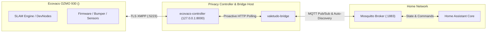

# Home Assistant & Valetudo Integration Guide: Ecovacs Deebot OZMO 930

The **Valetudo & Home Assistant MQTT Bridge** runs alongside the Ecovacs privacy controller.

It communicates with your local Mosquitto MQTT broker (`<HOST_IP>:1883`) and has published Home Assistant MQTT Auto-Discovery definitions, creating a single device with 10 integrated entities.

---

## 1. Auto-Discovered Home Assistant Device & Entities

**Device Name:** `Ecovacs Deebot OZMO 930`  
**Model:** `Deebot OZMO 930 (DR930)`  
**Manufacturer:** `Ecovacs`  
**Device Registry ID:** `329d3f2e181580c0e32026a9b2017729`

| Entity ID | Type | Purpose / Capabilities |
|---|---|---|
| `vacuum.ecovacs_deebot_ozmo_930_ecovacs_deebot_ozmo_930` | Vacuum | Start, Pause, Stop, Return to Base, Locate, Fan Speed selection (`silent`, `standard`, `strong`, `intelligent`), state (`docked`, `cleaning`, `returning`, `paused`, `idle`). |
| `camera.ecovacs_deebot_ozmo_930_ozmo_map` | Camera | Live map feed published to MQTT. Works out of the box in standard Home Assistant picture-entity and camera cards without custom cards. |
| `sensor.ecovacs_deebot_ozmo_930_ozmo_battery_level` | Sensor | Battery state of charge (0–100%). |
| `sensor.ecovacs_deebot_ozmo_930_ozmo_main_brush_lifespan` | Sensor | Main roller brush remaining lifespan percentage. |
| `sensor.ecovacs_deebot_ozmo_930_ozmo_side_brush_lifespan` | Sensor | Dual side brushes remaining lifespan percentage. |
| `sensor.ecovacs_deebot_ozmo_930_ozmo_dust_filter_lifespan` | Sensor | HEPA dustbin filter remaining lifespan percentage. |
| `binary_sensor.ecovacs_deebot_ozmo_930_ozmo_water_box_installed` | Binary Sensor | Detects if the mopping water tank & plate are physically clicked into the vacuum. |
| `select.ecovacs_deebot_ozmo_930_ozmo_water_flow_rate` | Select | Electronic mopping pump flow rate control (`Low`, `Medium`, `High`, `Max`). |
| `select.ecovacs_deebot_ozmo_930_ozmo_voice_prompt_soundboard` | Select | Soundboard dropdown with all 32 robot voice prompts (e.g. `00: Boot up chime`, `71: I am restoring map`, `84: I am ready for mopping`). |
| `number.ecovacs_deebot_ozmo_930_ozmo_speaker_volume` | Number | Speaker volume slider (0 to 100%, 5% step). |

---

## 2. Valetudo MQTT Topics

For integration with custom vacuum cards like `custom:valetudo-map-card` or `custom:xiaomi-vacuum-map-card`, the bridge exposes standard Valetudo topics under:

```
valetudo/<DEVICE_ID>/
```

- **ValetudoMap JSON v2:** `valetudo/<DEVICE_ID>/MapData/map_data`
- **Raw Map JPEG / PNG:** `valetudo/<DEVICE_ID>/map_image`
- **State & Battery Object:** `valetudo/<DEVICE_ID>/state`
- **Command Topic:** `valetudo/<DEVICE_ID>/command`
- **Fan Speed:** `valetudo/<DEVICE_ID>/fan_speed` (`set_fan_speed`)
- **Water Flow:** `valetudo/<DEVICE_ID>/water_flow` (`set_water_flow`)
- **Speaker Volume:** `valetudo/<DEVICE_ID>/volume` (`set_volume`)
- **Play Sound:** `valetudo/<DEVICE_ID>/play_sound`

---

## 3. Lovelace Dashboard Cards

### Option A: Standard Native Lovelace Card (No HACS Required)

```yaml
type: vertical-stack
cards:
  - type: vacuum
    entity: vacuum.ecovacs_deebot_ozmo_930_ecovacs_deebot_ozmo_930
  - type: picture-entity
    entity: camera.ecovacs_deebot_ozmo_930_ozmo_map
    show_state: false
    show_name: true
    name: "OZMO 930 Floor Plan"
  - type: entities
    title: "Mopping & Consumables"
    entities:
      - entity: binary_sensor.ecovacs_deebot_ozmo_930_ozmo_water_box_installed
      - entity: select.ecovacs_deebot_ozmo_930_ozmo_water_flow_rate
      - entity: number.ecovacs_deebot_ozmo_930_ozmo_speaker_volume
      - entity: select.ecovacs_deebot_ozmo_930_ozmo_voice_prompt_soundboard
      - entity: sensor.ecovacs_deebot_ozmo_930_ozmo_main_brush_lifespan
      - entity: sensor.ecovacs_deebot_ozmo_930_ozmo_side_brush_lifespan
      - entity: sensor.ecovacs_deebot_ozmo_930_ozmo_dust_filter_lifespan
```

### Option B: Custom Valetudo Map Card (`custom:valetudo-map-card`)

```yaml
type: custom:valetudo-map-card
vacuum: vacuum.ecovacs_deebot_ozmo_930_ecovacs_deebot_ozmo_930
valetudo_prefix: valetudo
valetudo_identifier: <DEVICE_ID>
title: "Living Room OZMO 930"
show_dock: true
show_path: true
show_camera: true
```

---

## 4. Architecture & Data Flow



---

## 5. Dashboard Configuration & Protocol Resolutions

### Dashboard Cards (`lovelace.vacuum`)
The vacuum dashboard is hosted at `/vacuum` (`lovelace.vacuum` storage key) and contains:
1. **`custom:valetudo-map-card`**: Real-time Valetudo floor plan displaying robot pose, charger location, paths, virtual walls, and no-go areas.
2. **`custom:xiaomi-vacuum-map-card`**: Interactive room selection (`vacuum_clean_segment`), rectangular zone drawing (`vacuum_clean_zone`), and pin navigation (`vacuum_goto`). Calibrated with 1:1 identity coordinates.
3. **`tile` (Deebot OZMO 930)**: Replaced invalid card type `vacuum`. Configured with `vacuum-commands` (`start_pause`, `stop`, `return_home`).
4. **`entities` (Mopping & Vacuum Controls)**:
   - `select.ecovacs_deebot_ozmo_930_ozmo_fan_speed` (Fan Speed: standard / strong)
   - `binary_sensor.ecovacs_deebot_ozmo_930_ozmo_water_box_installed` (Water Box Attachment)
   - `select.ecovacs_deebot_ozmo_930_ozmo_water_flow_rate` (Water Flow Rate: Low, Medium, High, Max)
   - `number.ecovacs_deebot_ozmo_930_ozmo_speaker_volume` (Volume 0-100%)
   - `select.ecovacs_deebot_ozmo_930_ozmo_voice_prompt_soundboard` (Voice Prompt Soundboard)
5. **`entities` (Sensors & Maintenance Lifespans)**:
   - Battery level & component wear lifespans (main brush, side brushes, dust filter).

### Resolved Protocol & Dashboard Issues
- **`Unknown type encountered: vacuum`**: Resolved by migrating to the official Lovelace `tile` card with `vacuum-commands` feature.
- **`Invalid calibration`**: Resolved by supplying explicit 1:1 calibration coordinates matching the Valetudo millimeter grid.
- **Start / Clean Command Protocol**: Reverse engineering of `plug_medusa_plugin_wifiHandler.so` from `research/930_DUMP` revealed that the OZMO 930 firmware parses the first character of attribute `act` on child element `<clean>`:
  - `'s'`: Start clean (requires `type="auto"`, `type="SpotArea"` with `mid` and `p`, or `type="spot"` with coordinates `p`)
  - `'p'`: Pause clean
  - `'r'`: Resume clean
  - `'h'`: Stop / halt clean (sending `act="stop"` previously failed because it starts with `'s'`)
  Sending `act="clean"` was rejected by firmware with `errno='1'`, causing the robot to ignore start commands.
- **Fan Speed State Synchronization**: Fixed optimistic in-memory caching of `CleanSpeed` in `handleSetFanSpeed` and added active polling via `GetCleanSpeed`, eliminating the UI snap-back. Added dedicated `select` entity for direct dashboard access.
