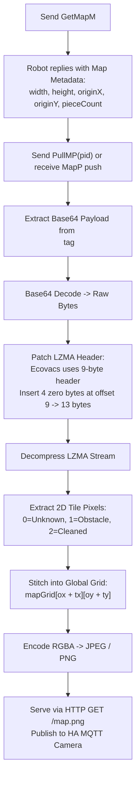
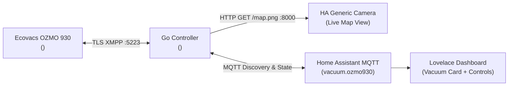

# Ecovacs Deebot OZMO 930: Command Catalog & Local Controller Architecture

## 1. Executive Summary

This document provides the definitive specification for running the **Ecovacs Deebot OZMO 930** (`DR930` / `DG3G` / Class `115` / SN `<DEVICE_ID>`) completely offline on a private local network (at `<HOST_IP>`), completely free of Bumper bloat and cloud dependencies.

It contains:
1. **The Complete Command Reference**: Every XML `<ctl td="...">` command supported by the Medusa firmware daemon and its plugins (`plug_wukong`, `plug_medusa_plugin_wifiHandler`, `plug_audio`, `plug_sys`, `plug_userman`, `plug_time`).
2. **The Map Extraction & Reconstruction Pipeline**: The exact protocol for `GetMapM`, `PullMP`, `MapP`, LZMA 9-to-13-byte header correction, tile grid coordinate stitching, and rendering.
3. **Lightweight Controller Architecture**: A clean architecture that provides the lookup endpoint (`:8007`), the TLS XMPP channel (`:5223`), and bridges telemetry, commands, and live maps directly into Home Assistant.

---

## 2. Complete Command Reference

All commands are exchanged over the active TLS XMPP session inside an IQ stanza:
```xml
<iq type="set" to="{ROBOT_SN}@{DEV_CLASS}.ecorobot.net/atom" from="ecouser.net">
  <query xmlns="com:ctl">
    <ctl td="{COMMAND_NAME}" id="{REQUEST_ID}" ... />
  </query>
</iq>
```
The robot replies with:
```xml
<iq type="result" id="{REQUEST_ID}" from="{ROBOT_SN}@{DEV_CLASS}.ecorobot.net/atom">
  <query xmlns="com:ctl">
    <ctl td="{COMMAND_NAME}" ... />
  </query>
</iq>
```

### 2.1 Cleaning Controls

| Command (`td`) | Attributes / XML Payload | Response XML | Description |
| :--- | :--- | :--- | :--- |
| `Clean` | `act="s"` `type="auto"` | `<ctl td="Clean" ret="ok"/>` | Start / Resume automatic whole-house cleaning (Task 0). |
| `Clean` | `act="p"` | `<ctl td="Clean" ret="ok"/>` | Pause active cleaning task (`act="p"`). |
| `Clean` | `act="h"` | `<ctl td="Clean" ret="ok"/>` | Stop/halt active cleaning task and return to idle (`act="h"`). |
| `Clean` | `act="r"` | `<ctl td="Clean" ret="ok"/>` | Resume paused cleaning task (`act="r"`). |
| `Clean` | `act="s"` `type="SpotArea"` `mid="{MID_LIST}"` `deep="1"` | `<ctl td="Clean" ret="ok"/>` | Clean specific spot area(s) / rooms (Task 2, e.g. `mid="0,1"`). **Must not include `p`**. |
| `Clean` | `act="s"` `type="SpotArea"` `p="{X1,Y1,X2,Y2}"` `deep="1"` | `<ctl td="Clean" ret="ok"/>` | Clean custom rectangular zone coordinates (Task 9). **Must not include `mid`**. |
| `Clean` | `act="s"` `type="spot"` `p="{X,Y}"` | `<ctl td="Clean" ret="ok"/>` | Single-point localized spot clean (Task 1). |
| `GetCleanState` | None | `<ctl td="GetCleanState" type="auto" state="clean" act="clean"/>` | Query current cleaning state (`clean`, `pause`, `stop`, `idle`). |
| `GetCleanSum` | None | `<ctl td="GetCleanSum" totalCount="45" totalTime="3600" totalArea="150"/>` | Lifetime cleaning statistics (count, total seconds, sq. meters). |
| `GetCleanLogs` | `count="10"` | `<ctl td="GetCleanLogs"><log id="1" t="1609459200" time="1800" area="45" .../></ctl>` | Retrieve past clean history records. |
| `EmptyCleanLog` / `EmptyLog` | None | `<ctl td="EmptyCleanLog" ret="ok"/>` | Clear stored clean logs in `/data/config/medusa/cleanlog.json`. |
| `GetAppWorkMode` | None | `<ctl td="GetAppWorkMode" mode="auto"/>` | Get active work mode. |

### 2.2 Charging & Battery

| Command (`td`) | Attributes / XML Payload | Response XML | Description |
| :--- | :--- | :--- | :--- |
| `Charge` | `act="goBack"` | `<ctl td="Charge" ret="ok"/>` | Order robot to return to charging dock. |
| `Charge` | `act="stop"` | `<ctl td="Charge" ret="ok"/>` | Stop returning to dock. |
| `GetChargeState` | None | `<ctl td="GetChargeState" isCharging="1" type="SlotCharging"/>` | Query charging state (`SlotCharging`, `Idle`, `Going`). |
| `GetBatteryInfo` | None | `<ctl td="GetBatteryInfo"><battery power="95"/></ctl>` | Query battery charge level (percentage `0`-`100`). |

### 2.3 Manual Direction & Motion (`Move`)

| Command (`td`) | Attributes / XML Payload | Response XML | Description |
| :--- | :--- | :--- | :--- |
| `Move` | `act="forward"` | `<ctl td="Move" ret="ok"/>` | Drive robot forward. |
| `Move` | `act="backward"` | `<ctl td="Move" ret="ok"/>` | Drive robot in reverse. |
| `Move` | `act="left"` | `<ctl td="Move" ret="ok"/>` | Steer left while driving. |
| `Move` | `act="right"` | `<ctl td="Move" ret="ok"/>` | Steer right while driving. |
| `Move` | `act="spin_left"` | `<ctl td="Move" ret="ok"/>` | Rotate in place counter-clockwise. |
| `Move` | `act="spin_right"` | `<ctl td="Move" ret="ok"/>` | Rotate in place clockwise. |
| `Move` | `act="turn_around"` | `<ctl td="Move" ret="ok"/>` | Perform 180° turn. |
| `Move` | `act="stop"` | `<ctl td="Move" ret="ok"/>` | Stop manual driving immediately. |

### 2.4 Map & Spatial Commands

| Command (`td`) | Attributes / XML Payload | Response XML | Description |
| :--- | :--- | :--- | :--- |
| `GetMapM` | None | `<ctl td="GetMapM" mid="..." msid="..." p="64" w="800" h="800" ox="-400" oy="-400"/>` | Fetch primary map header (dimensions, origin, piece count). |
| `PullMP` | `pid="{PIECE_ID}"` | `<ctl td="PullMP" pid="1" msid="..." mid="..."><p>{BASE64_LZMA}</p></ctl>` | Request a specific map tile chunk by ID (`1` to `p`). |
| `GetMapSet` | `tp="sa"` | `<ctl td="GetMapSet" tp="sa"><sa id="0" name="Room 1" p="x1,y1,..."/></ctl>` | Retrieve room partitions (Spot Areas) polygons. |
| `GetMapSet` | `tp="vw"` | `<ctl td="GetMapSet" tp="vw"><vw id="1" p="x1,y1,x2,y2"/></ctl>` | Retrieve Virtual Walls / No-Go barriers. |
| `SetMapAutoReport` | `on="1"` or `on="0"` | `<ctl td="SetMapAutoReport" ret="ok"/>` | Enable/disable live map stream during cleaning. |
| `ClearMap` | None | `<ctl td="ClearMap" ret="ok"/>` | Erase stored SLAM map from device. |
| `RecoverMap` | None | `<ctl td="RecoverMap" ret="ok"/>` | Restore previous saved map from backup. |
| `IfHaveMap` | None | `<ctl td="IfHaveMap" have="1"/>` | Query if valid map is loaded in memory. |
| `GetMapSt` | None | `<ctl td="GetMapSt" st="normal"/>` | Get map state (`normal`, `building`, `recovering`). |
| `GetTrM` | None | `<ctl td="GetTrM" trid="..." p="10"/>` | Fetch clean trajectory/trace metadata. |
| `GetTr` | `pid="{PIECE_ID}"` | `<ctl td="GetTr" pid="1"><tr p="x1,y1,x2,y2..."/></ctl>` | Fetch robot path trajectory coordinate points. |
| `GetPos` | None | `<ctl td="GetPos" x="120" y="-45" a="89"/>` | Get current robot position ($x, y$ mm, angle degrees). |
| `GetChargerPos` | None | `<ctl td="GetChargerPos" x="0" y="0" a="0"/>` | Get charging dock position coordinates. |

### 2.5 Hardware, Audio & Mopping

| Command (`td`) | Attributes / XML Payload | Response XML | Description |
| :--- | :--- | :--- | :--- |
| `PlaySound` | `sid="30"` | `<ctl td="PlaySound" ret="ok"/>` | Trigger audio prompt by ID. |
| `GetVolume` | None | `<ctl td="GetVolume"><volume val="85"/></ctl>` | Get speaker volume level (`0`-`100`). |
| `SetVolume` | `val="{0-100}"` | `<ctl td="SetVolume" ret="ok"/>` | Set speaker volume level. |
| `GetLanguages` | None | `<ctl td="GetLanguages"><languages inuse="EN"><l id="EN"/><l id="DE"/>...</languages></ctl>` | Query installed voice prompt language packs. |
| `SetActiveLanguage`| `id="EN"` | `<ctl td="SetActiveLanguage" ret="ok"/>` | Set active voice language pack. |
| `GetWaterBoxInfo`| None | `<ctl td="GetWaterBoxInfo" on="1"/>` | Query if OZMO mopping reservoir is installed. |
| `GetWaterPermeability`| None | `<ctl td="GetWaterPermeability" v="2"/>` | Query water flow rate (`1`=Low, `2`=Med, `3`=High, `4`=Max). |
| `SetWaterPermeability`| `v="{1-4}"` | `<ctl td="SetWaterPermeability" ret="ok"/>` | Set water flow rate. |

#### Complete Voice Prompt & Sound Catalog (`/media/music/<LANG>/<SID>.ogg`)

All sound prompts reside on the robot in `/media/music/<LANG>/` as vorbis `.ogg` files. You can query the full list via `GET /sounds` or trigger any prompt via `POST /playSound?sid=<ID>`.

| Sound ID (`sid`) | Constant Identifier | Voice Prompt / Description |
| :---: | :--- | :--- |
| `0` | `BOOT_UP` | Boot up chime |
| `3` | `SOUND_SUSPENDED` | "I am suspended" |
| `4` | `SOUND_CHECK_WHEELS` | "Please check the driving wheels" |
| `5` | `SOUND_HELP_ME` | "Please help me out" |
| `6` | `SOUND_INSTALL_DUST_BIN`| "Please install dust bin" |
| `17` | `SOUND_DING` | "Ding" (chime alert) |
| `18` | `SOUND_BATTERY_LOW` | "My battery is low" |
| `29` | `SOUND_POWER_ON_CHARGING`| "Please power me on before charging" |
| `30` | `SOUND_I_AM_HERE` | "I am here" (Locate robot) |
| `31` | `SOUND_BRUSH_TANGLED` | "Brush is tangled, please clean my brush" |
| `35` | `SOUND_CLEAN_SENSORS` | "Please clean my anti-drop sensors" |
| `48` | `SOUND_BRUSH_TANGLED_2` | "Brush is tangled, please clean my brush" (variant) |
| `55` | `SOUND_RELOCATING` | "I am relocating" |
| `56` | `SOUND_UPGRADE_SUCCESS` | "Upgrade succeeded" |
| `63` | `SOUND_RETURNING_DOCK` | "I am returning to the charging dock" |
| `65` | `SOUND_CLEANING_PAUSED` | "Cleaning paused" |
| `69` | `SOUND_WIFI_CONNECTED` | "Connected, please go back to the ECOVACS App" |
| `71` | `SOUND_RESTORING_MAP` | "I am restoring the map, please don't stand beside me" |
| `73` | `SOUND_BATTERY_LOW_DOCK`| "My battery is low, returning to the charging dock" |
| `74` | `SOUND_RELOCATE_FAIL` | "Difficult to locate, I am starting a new cleaning cycle" |
| `75` | `SOUND_RESUMING_CLEAN` | "I am resuming the clean" |
| `76` | `SOUND_UPGRADE_FAILED` | "Upgrade failed, please try again" |
| `77` | `SOUND_PLACE_ON_DOCK` | "Please place me on the charging dock" |
| `79` | `SOUND_RESUME_CLEAN` | "Resume the clean" |
| `80` | `SOUND_STARTING_CLEAN` | "I am starting the clean" |
| `81` | `SOUND_STARTING_CLEAN_2`| "I am starting the clean" (spot area mode) |
| `82` | `SOUND_STARTING_CLEAN_3`| "I am starting the clean" (custom area mode) |
| `84` | `SOUND_READY_FOR_MOPPING`| "I am ready for mopping" |
| `85` | `SOUND_REMOVE_MOP_PLATE`| "Please remove the mopping plate, I am building the map" |
| `86` | `SOUND_CLEAN_COMPLETE` | "Cleaning is complete, returning to the charging dock" |
| `89` | `SOUND_LDS_MALFUNCTION` | "LDS malfunction, please try to tap the LDS" |
| `90` | `SOUND_UPGRADING` | "I am upgrading, please wait" |
| `SetWaterPermeability`| `v="{1-4}"` | `<ctl td="SetWaterPermeability" ret="ok"/>` | Set water pump flow rate. |

### 2.6 Consumables Lifespan

| Command (`td`) | Attributes / XML Payload | Response XML | Description |
| :--- | :--- | :--- | :--- |
| `GetLifeSpan` | `type="Brush"` | `<ctl td="GetLifeSpan" type="Brush" val="82"/>` | Main roller brush remaining lifespan percentage. |
| `GetLifeSpan` | `type="SideBrush"` | `<ctl td="GetLifeSpan" type="SideBrush" val="64"/>` | Dual side brushes remaining lifespan percentage. |
| `GetLifeSpan` | `type="DustCaseHeap"`| `<ctl td="GetLifeSpan" type="DustCaseHeap" val="75"/>` | HEPA dust filter remaining lifespan percentage. |
| `ResetLifeSpan` | `type="{COMPONENT}"` | `<ctl td="ResetLifeSpan" ret="ok"/>` | Reset consumable wear counter to 100%. |

### 2.7 Settings, Do-Not-Disturb & Schedules

| Command (`td`) | Attributes / XML Payload | Response XML | Description |
| :--- | :--- | :--- | :--- |
| `GetBlockTime` | None | `<ctl td="GetBlockTime" on="1" sH="22" sM="0" eH="7" eM="0"/>` | Get DND quiet hours start/end time. |
| `SetBlockTime` | `on="1" sH="22" sM="0" eH="7" eM="0"` | `<ctl td="SetBlockTime" ret="ok"/>` | Configure DND quiet hours. |
| `GetOnOff` | `type="BlockTime"` | `<ctl td="GetOnOff" type="BlockTime" on="1"/>` | Check if DND mode is enabled. |
| `SetOnOff` | `type="BlockTime" on="1"` | `<ctl td="SetOnOff" ret="ok"/>` | Enable/disable DND mode. |
| `SetOnOff` | `type="Carpet" on="1"` | `<ctl td="SetOnOff" ret="ok"/>` | Enable/disable Carpet Detection / Auto-Boost. |
| `SetOnOff` | `type="ContinueClean" on="1"` | `<ctl td="SetOnOff" ret="ok"/>` | Enable/disable Continuous Cleaning (recharge & resume). |
| `GetSleepStatus` | None | `<ctl td="GetSleepStatus" st="0"/>` | Query sleep status (`0`=awake, `1`=sleeping). |
| `GetSched` | None | `<ctl td="GetSched"><s id="1" t="08:00" w="1,2,3,4,5" en="1"/></ctl>` | List scheduled cleaning events. |
| `AddSched` | `<s t="08:00" w="1,2,3,4,5" en="1" act="clean"/>` | `<ctl td="AddSched" id="1" ret="ok"/>` | Add new cleaning timer. |
| `DelSched` | `id="1"` | `<ctl td="DelSched" ret="ok"/>` | Delete cleaning timer. |
| `SetTime` | `t="1609459200" tz="0" tzm="0"` | `<ctl td="SetTime" ret="ok"/>` | Synchronize vacuum system clock (Unix epoch). |

### 2.8 System, Info & Access Control

| Command (`td`) | Attributes / XML Payload | Response XML | Description |
| :--- | :--- | :--- | :--- |
| `GetVersion` | None | `<ctl td="GetVersion" ver="1.9.9" mcu="1.2.3"/>` | Query ARM & MCU firmware versions. |
| `GetWKVer` | None | `<ctl td="GetWKVer" ver="2.1.0"/>` | Query Wukong communication stack version. |
| `GetDeviceInfo` | None | `<ctl td="GetDeviceInfo" sn="..." mac="..." class="115"/>` | Query serial number, MAC address, hardware class. |
| `GetError` | None | `<ctl td="GetError" errs="0"/>` | Query active hardware error code (`0` = OK). |
| `PowerOff` | None | `<ctl td="PowerOff" ret="ok"/>` | Software shutdown of the robot. |
| `FactoryReset` | None | `<ctl td="FactoryReset" ret="ok"/>` | Reset configuration partition to defaults. |
| `AddUser` | `jid="admin@ecouser.net"` | `<ctl td="AddUser" ret="ok"/>` | Register authorized controller JID. |
| `SetAC` | `jid="admin@ecouser.net"`<br>`<acs><ac name="userman" allow="1"/><ac name="setting" allow="1"/><ac name="clean" allow="1"/></acs>` | `<ctl td="SetAC" ret="ok"/>` | Grant access permissions (`clean`, `setting`, `userman`). Resolves error 103. |

---

## 3. Map Extraction & Decoding Pipeline



### The 9-Byte LZMA Header Patch
The Ecovacs SLAM plugin compresses map tile chunks using LZMA, but truncates the standard 13-byte LZMA header down to 9 bytes:
- Standard LZMA: `5 bytes properties` + `8 bytes uncompressed size (uint64)`.
- Ecovacs LZMA: `5 bytes properties` + `4 bytes uncompressed size (uint32)`.

To decompress in Go or Python, insert four `0x00` bytes at index 9:
```go
// header fix in Go (from api_client/responses.go)
lzmaHeader := make([]byte, 13)
copy(lzmaHeader[:9], rawCompressed[:9])
lzmaHeader[9] = 0
lzmaHeader[10] = 0
lzmaHeader[11] = 0
lzmaHeader[12] = 0
fullStream := append(lzmaHeader, rawCompressed[9:]...)
```

---

## 4. Architectural Comparison: Go vs Python

| Criteria | Option A: Extended Go Client (`api_client`) | Option B: Python Microservice (from `xmppserver.py`) |
| :--- | :--- | :--- |
| **Existing Repo Work** | High (`responses.go` map decoder, `commands.go`, `api.go` already complete). | Low (Must adapt `xmppserver.py` and rewrite map decoding in Python). |
| **Dependencies** | **Zero runtime dependencies** (single static Go binary). | Requires Python 3, `aiohttp`, `asyncio`, `Pillow`, `paho-mqtt`. |
| **Memory Footprint** | **~15 MB RAM** (ideal for lightweight containers or embedded devices). | ~60-90 MB RAM. |
| **Robot Compatibility** | 100% compliant with `:8007` lookup and `:5223` TLS XMPP. | 100% compliant with `:8007` lookup and `:5223` TLS XMPP. |
| **Preservation Rule** | Leaves `mqtt_connect.go` completely untouched. Adds `xmpp_server.go`. | Creates standalone script; repo Go code unused. |

### Recommended Path: Option A (Lightweight Go Service)
Extending the existing Go service in `api_client/` keeps everything in a single, ultra-fast binary that uses almost no RAM, preserves `mqtt_connect.go`, reuses the existing map tile stitcher, and provides both the HTTP REST API and Home Assistant integration.

---

## 5. Home Assistant Integration Architecture



### 1. Home Assistant Vacuum Entity (Auto-Discovery)
On startup, the controller publishes MQTT auto-discovery configuration to:
`homeassistant/vacuum/ozmo930/config`
```json
{
  "name": "Deebot OZMO 930",
  "unique_id": "ozmo930_vacuum",
  "schema": "state",
  "supported_features": ["start", "pause", "stop", "return_home", "battery", "status", "locate"],
  "command_topic": "vacuum/ozmo930/command",
  "state_topic": "vacuum/ozmo930/state",
  "device": {
    "identifiers": ["<DEVICE_ID>"],
    "name": "Deebot OZMO 930",
    "model": "OZMO 930 (DR930)",
    "manufacturer": "Ecovacs"
  }
}
```

### 2. Live Map in Home Assistant
Two zero-friction ways to display the map:
1. **Generic Camera**:
   ```yaml
   camera:
     - platform: generic
       name: Deebot OZMO 930 Map
       still_image_url: http://<HOST_IP>:8000/map.png
   ```
2. **Vacuum Map Card**: Lovelace card pointing directly to `camera.deebot_ozmo_930_map`.
