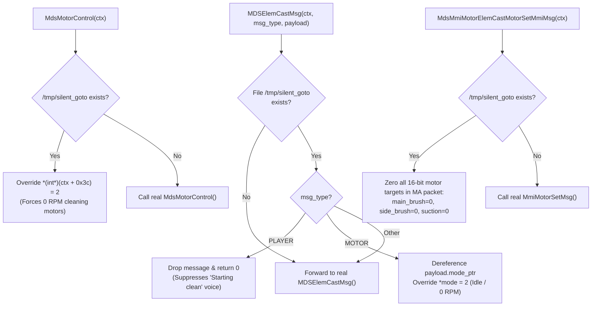
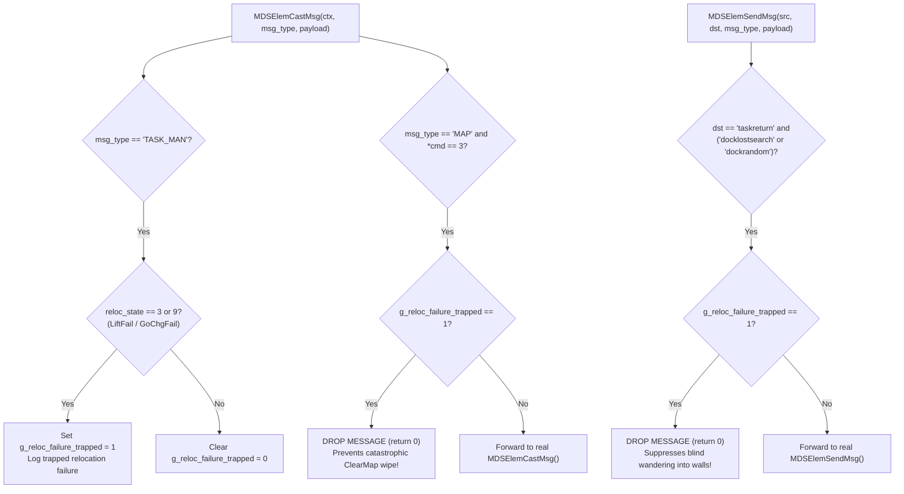

# Comprehensive Reverse Engineering & Protocol Documentation: Ecovacs Deebot OZMO 930 (DR930 / DG70)

This document represents the definitive, publication-grade reference of the reverse engineering analysis conducted on the **Ecovacs Deebot OZMO 930** (`DR930` / `DG70` / `DG3G` / Class `115`) firmware binaries (`research/930_DUMP`), the Medusa daemon architecture, hardware bus mappings, and the decompiled official Android client application (`research/apps/com.eco.global.app(3).apk_Decompiler.com`).

All symbol addresses, virtual memory offsets, decompiled C pseudocode, ARM disassembly routines, and protocol formats contained herein are derived strictly and exclusively from the official factory OZMO 930 firmware dump.

---

## Table of Contents
1. [Executive Summary & Core Architectural Invariants](#1-executive-summary--core-architectural-invariants)
2. [Internal Medusa IPC & Element Dispatch Architecture (`medusa`)](#2-internal-medusa-ipc--element-dispatch-architecture-medusa)
   - [A. Component & Element Architecture (`MDSElem` & `MDSElemClass`)](#a-component--element-architecture-mdselem--mdselemclass)
   - [B. Element Lookup: `MDSServerFindElemByName` (`0x131a0`)](#b-element-lookup-mdsserverfindelembyname-0x131a0)
   - [C. Broadcast IPC: `MDSElemCastMsg` (`0x12624`)](#c-broadcast-ipc-mdselemcastmsg-0x12624)
   - [D. Directed Message Dispatch: `MDSElemSendMsg` (`0x126d0`)](#d-directed-message-dispatch-mdselemsendmsg-0x126d0)
   - [E. Synchronous Element Execution: `MDSElemCallProcess` (`0x12798`)](#e-synchronous-element-execution-mdselemcallprocess-0x12798)
   - [F. Element Registration & Plugin Lifecycle](#f-element-registration--plugin-lifecycle)
3. [Command Dispatcher & XML Handlers (`plug_medusa_plugin_wifiHandler.so`)](#3-command-dispatcher--xml-handlers-plug_medusa_plugin_wifihandlerso)
   - [A. Command Dispatch Table (`getCtlHandlerFromTdStz` @ `0x1c224`)](#a-command-dispatch-table-getctlhandlerfromtdstz--0x1c224)
   - [B. Decompiled `Clean` Handler (`0x183c0`)](#b-decompiled-clean-handler-0x183c0)
   - [C. Decompiled `Move` Handler (`0x165d0`)](#c-decompiled-move-handler-0x165d0)
   - [D. Fan Speed Hardcoding & Absence of Software Speed Control](#d-fan-speed-hardcoding--absence-of-software-speed-control)
   - [E. Decompiled Firmware Stubs: `RecoverMap` (`0x1a478`) & `IfHaveMap` (`0x1a534`)](#e-decompiled-firmware-stubs-recovermap-0x1a478--ifhavemap-0x1a534)
4. [Task Management & Motor Control Coupling (`plug_mmi_periph.so`)](#4-task-management--motor-control-coupling-plug_mmi_periphso)
   - [A. Decompiled `MdsStartTask` (`0x28bdc`)](#a-decompiled-mdsstarttask-0x28bdc)
   - [B. Decompiled `MDSMotorControl` (`0x29724`)](#b-decompiled-mdsmotorcontrol-0x29724)
   - [C. Motor Mode Dispatch `FUN_00021ed4` (`0x21ed4`)](#c-motor-mode-dispatch-fun_00021ed4-0x21ed4)
   - [D. Baseline & Carpet Boost Motor Speeds (`0x2e6e8`)](#d-baseline--carpet-boost-motor-speeds-0x2e6e8)
   - [E. Microcontroller UART Motor Speed Framing (`0x2e528`)](#e-microcontroller-uart-motor-speed-framing-0x2e528)
   - [F. Sensor Telemetry & Safety Cutoff Engine (`MdsMmiMotorProcess` @ `0x2ea68`)](#f-sensor-telemetry--safety-cutoff-engine-mdsmmimotorprocess--0x2ea68)
5. [Native Go-To Architecture & Point Transit (`TASK_GOPT`)](#5-native-go-to-architecture--point-transit-task_gopt)
   - [A. Element Registration & Class Definition (`0x4f128`)](#a-element-registration--class-definition-0x4f128)
   - [B. Decompiled `TASK_GOPT` Start Routine (`0x1af60`)](#b-decompiled-task_gopt-start-routine-0x1af60)
   - [C. Invocation Payload Structure & Call Path](#c-invocation-payload-structure--call-path)
   - [D. Arrival Event 4 & Completion Signaling](#d-arrival-event-4--completion-signaling)
   - [E. Physical Motor Decoupling during `TASK_GOPT`](#e-physical-motor-decoupling-during-task_gopt)
6. [Relocation Engine & Map-Wipe Failure Modes (`task_relocation.so`)](#6-relocation-engine--map-wipe-failure-modes-task_relocationso)
   - [A. The `TASK_MAN` Relocation State Machine (States 1–9)](#a-the-task_man-relocation-state-machine-states-19)
   - [B. Catastrophic Failure Sequence (States 3 & 9)](#b-catastrophic-failure-sequence-states-3--9)
   - [C. Decompiled `HandleRelocation2Report` (`0xd418`)](#c-decompiled-handlerelocation2report-0xd418)
   - [D. Map Preservation Architecture (`libpersistmap.so`)](#d-map-preservation-architecture-libpersistmapso)
7. [Flash Storage Formats & Calibration Structs (`/data/FILES/`)](#7-flash-storage-formats--calibration-structs-datafiles)
   - [A. SLAM Occupancy Grid: `restoreMap.bin`](#a-slam-occupancy-grid-restoremapbin)
   - [B. Robot Pose Calibration: `restorePose.bin`](#b-robot-pose-calibration-restoreposebin)
   - [C. Charging Dock Coordinates: `restoreChargerStand.bin`](#c-charging-dock-coordinates-restorechargerstandbin)
   - [D. Cleaning Session & Ergodic Coverage: `ergodic.bin`](#d-cleaning-session--ergodic-coverage-ergodicbin)
   - [E. Boundary & Sensor Calibration: `restoreVirtualWall.bin` & `restoreCarpet.bin`](#e-boundary--sensor-calibration-restorevirtualwallbin--restorecarpetbin)
   - [F. Stale Dock Coordinate Localization Bug & Calibration](#f-stale-dock-coordinate-localization-bug--calibration)
8. [Audio Subsystem, NAU8810 Codec & DAC Latency](#8-audio-subsystem-nau8810-codec--dac-latency)
   - [A. Hardware Audio Pipeline & NAU8810 I2S Interface](#a-hardware-audio-pipeline--nau8810-i2s-interface)
   - [B. RK3188 Power-Gate Latency & 350ms Padding Requirement](#b-rk3188-power-gate-latency--350ms-padding-requirement)
   - [C. Audio Catalog & Custom Soundboard Mapping](#c-audio-catalog--custom-soundboard-mapping)
   - [D. SquashFS Persistence via `/data` Bind Mounts](#d-squashfs-persistence-via-data-bind-mounts)
9. [XML Protocol Specifications & Mutual Exclusion Rules](#9-xml-protocol-specifications--mutual-exclusion-rules)
   - [A. TLS XMPP Command Envelope](#a-tls-xmpp-command-envelope)
   - [B. Room Cleaning (`mid`) vs Zone Cleaning (`p`) Mutual Exclusion](#b-room-cleaning-mid-vs-zone-cleaning-p-mutual-exclusion)
   - [C. Single-Point Spot Cleaning (`type="spot"`)](#c-single-point-spot-cleaning-typespot)
   - [D. Official Android App Logic (`DR930.java` & `EcoRobotProtocol.java`)](#d-official-android-app-logic-dr930java--ecorobotprotocoljava)
10. [Hardware Exploitation, Root Access & Boot Persistence](#10-hardware-exploitation-root-access--boot-persistence)
    - [A. Udev USB Auto-Execution Vulnerability (`/usr/bin/udisk.sh`)](#a-udev-usb-auto-execution-vulnerability-usrbinudisksh)
    - [B. Boot Process & Autostart Architecture (`/etc/rc.d/autostart.sh`)](#b-boot-process--autostart-architecture-etcrcdautostartsh)
    - [C. Dynamic Root Password Derivation (`eco_passwd`)](#c-dynamic-root-password-derivation-eco_passwd)
    - [D. Hardware Console & Bus Pinouts](#d-hardware-console--bus-pinouts)
11. [Runtime Interception Engines (`libsilentgoto.so` & `libpersistmap.so`)](#11-runtime-interception-engines-libsilentgotoso--libpersistmapso)
    - [A. Injection Architecture (`LD_PRELOAD`)](#a-injection-architecture-ld_preload)
    - [B. Silent Transit Hook Flowchart](#b-silent-transit-hook-flowchart)
    - [C. Map Preservation Hook Flowchart](#c-map-preservation-hook-flowchart)
12. [Verification & Reference Checksum Summary](#12-verification--reference-checksum-summary)
13. [Firmware Batch Decompilation Catalog & Source Manifest](#13-firmware-batch-decompilation-catalog--source-manifest)

---

## 1. Executive Summary & Core Architectural Invariants

Reverse engineering the Deebot OZMO 930 firmware binaries reveals five immutable architectural invariants:

1. **No Software Fan Speed Regulation**: The OZMO 930 lacks software-governed suction fan speed levels. The hardware relies exclusively on a physical carpet detection switch connected to the auxiliary STM32 microcontroller. Baseline suction is fixed at 11,000 RPM; Carpet Pressurization Boost runs at 15,000 RPM. The Medusa command dispatcher ignores `SetCleanSpeed`, and telemetry handlers unconditionally hardcode `speed="standard"`.
2. **Autonomous Transit Requires Cleaning Task Coupling**: In factory firmware, autonomous SLAM path planning is exclusively coupled to cleaning tasks: Auto Clean (Task 0), Spot Clean (Task 1), Room Clean (Task 2), or Custom Zone Clean (Task 9). All four unconditionally trigger `MDSMotorControl`, spinning suction and brush motors at full cleaning speeds during transit.
3. **Silent Autonomous Navigation Exists Only for Docking**: The only autonomous SLAM navigation routine in factory firmware that runs silently without suction is Task Type 3 (`MdsStartReturnTask` / return to dock).
4. **Room (`mid`) vs Zone (`p`) Mutual Exclusion**:
   - Spot Area with Room IDs (`mid`): `<clean act="s" type="SpotArea" mid="0,1" deep="1"/>`. The `p` attribute **MUST NOT** be present.
   - Spot Area with Coordinates (`p`): `<clean act="s" type="SpotArea" p="x1,y1,x2,y2" deep="1"/>`. The `mid` attribute **MUST NOT** be present.
   - If both `mid` and `p` are sent, the firmware parser aborts with `spotArea has mid and p` and rejects the task (`TaskType 2`).
5. **Catastrophic Relocation Map Purge**: If relocation times out during docking or wheel suspension (states 3 and 9 of `TASK_MAN`), the factory firmware discards the active SLAM map from volatile RAM, zeroes odometry coordinates to `(0, 0)`, and enters `docklostsearch` / `dockrandom` (circling in blind arcs and ramming obstacles).

---

## 2. Internal Medusa IPC & Element Dispatch Architecture (`medusa`)

The core daemon running on the OZMO 930 is `/usr/bin/medusa`. It implements a lightweight, modular component framework based on interconnected "elements" (`MDSElem`) and "element classes" (`MDSElemClass`).

```
+-----------------------------------------------------------------------------------+
|                                  MDSServer                                        |
|  +-----------------------------------------------------------------------------+  |
|  | elem_list (offset +0x70) -> [MDSElem: taskGoto] <-> [MDSElem: periph] <-> ... |  |
|  +-----------------------------------------------------------------------------+  |
+-----------------------------------------------------------------------------------+
       ^                                  ^                                  ^
       | MDSServerFindElemByName          | MDSElemCastMsg                   | MDSElemCallProcess
       v                                  v                                  v
+------------------+             +------------------+              +------------------+
|   MDSElem        |             |   MDSElem        |              |   MDSElem        |
|  +0x00: refCount |             |  +0x18: guest_list--------+     |  +0x08: elem_class
|  +0x04: server*  |             |  +0x1c: vendor_list      |     |           |
|  +0x08: class*   |             +------------------+       |     |           v
|  +0x0c: name     |                                        v     |  +0x0c: process_cb()
+------------------+                              +---------------+------------------+
                                                  | Guest Element: process_cb()      |
                                                  +----------------------------------+
```

### A. Component & Element Architecture (`MDSElem` & `MDSElemClass`)

In `medusa`, every functional module (such as `taskGoto`, `wifiHandler`, `periph`, `task_relocation`) is instantiated as an `MDSElem`.

#### `MDSElem` Structure (Size: 32 bytes)
```c
typedef struct MDSElem {
    uint32_t ref_count;          // +0x00: Reference counter
    struct MDSServer *server;    // +0x04: Pointer to owning MDSServer instance
    struct MDSElemClass *class;  // +0x08: Pointer to class virtual function table
    char name[12];               // +0x0c: Null-terminated element identifier (e.g. "taskGoto")
    struct MDSList *guests;      // +0x18: Linked list of subscriber elements (outgoing)
    struct MDSList *vendors;     // +0x1c: Linked list of provider elements (incoming)
} MDSElem;
```

#### `MDSElemClass` Structure (Size: 36 bytes)
```c
typedef struct MDSElemClass {
    const char *class_name;      // +0x00: Class identifier string (e.g. "TASK_GOPT")
    int (*init_cb)(MDSElem *);   // +0x04: Instance initializer callback
    int (*exit_cb)(MDSElem *);   // +0x08: Instance destructor callback
    int (*process_cb)(MDSElem *dst, MDSElem *src, void *msg); // +0x0c: Message handler
    int (*notify_cb)(MDSElem *, void *);                      // +0x10: State notification callback
    int (*connect_cb)(MDSElem *, MDSElem *);                  // +0x14: Connection callback
    int (*disconnect_cb)(MDSElem *, MDSElem *);               // +0x18: Disconnection callback
    void *reserved[2];           // +0x1c .. +0x24
} MDSElemClass;
```

### B. Element Lookup: `MDSServerFindElemByName` (`0x131a0`)

Located at address `0x131a0` in `/usr/bin/medusa`, this routine traverses the server's master element linked list at offset `server + 0x70`:

```c
MDSElem *MDSServerFindElemByName(MDSServer *server, const char *name) {
    if (!server || !server->elem_list) {
        return NULL;
    }
    
    MDSListNode *node = server->elem_list;
    while (node != NULL) {
        MDSElem *elem = (MDSElem *)node->data;
        if (elem && elem->name) {
            if (strcmp(elem->name, name) == 0) {
                return elem; // Match found
            }
        }
        node = node->next;
    }
    return NULL; // Not found
}
```

### C. Broadcast IPC: `MDSElemCastMsg` (`0x12624`)

Located at address `0x12624` in `/usr/bin/medusa`, `MDSElemCastMsg` iterates over an element's subscriber list (`guests` at offset `+0x18`) and invokes each subscriber's `process_cb`:

```c
uint32_t MDSElemCastMsg(MDSElem *src_elem, const char *msg_type, void *payload) {
    uint32_t result = 0;
    struct {
        char name[12];
        void *payload;
    } msg_envelope;
    
    if (!src_elem || !src_elem->guests) {
        return 0;
    }
    
    strncpy(msg_envelope.name, msg_type, 11);
    msg_envelope.name[11] = '\0';
    msg_envelope.payload = payload;
    
    MDSListNode *curr = src_elem->guests;
    while (curr != NULL) {
        MDSElem *guest = (MDSElem *)curr->data;
        if (guest && guest->class && guest->class->process_cb) {
            uint32_t ret = guest->class->process_cb(guest, src_elem, &msg_envelope);
            result |= ret;
        }
        curr = curr->next;
    }
    return result;
}
```

### D. Directed Message Dispatch: `MDSElemSendMsg` (`0x126d0`)

Located at address `0x126d0` in `/usr/bin/medusa`, `MDSElemSendMsg` delivers a message exclusively to connected guests matching a specific destination name:

```c
int MDSElemSendMsg(MDSElem *src_elem, const char *dst_name, const char *msg_type, void *payload) {
    struct {
        char name[12];
        void *payload;
    } msg_envelope;
    
    if (!src_elem || !src_elem->guests) {
        return -1;
    }
    
    strncpy(msg_envelope.name, msg_type, 11);
    msg_envelope.payload = payload;
    
    MDSListNode *curr = src_elem->guests;
    while (curr != NULL) {
        MDSElem *guest = (MDSElem *)curr->data;
        if (guest && guest->name && strcmp(guest->name, dst_name) == 0) {
            if (guest->class && guest->class->process_cb) {
                return guest->class->process_cb(guest, src_elem, &msg_envelope);
            }
        }
        curr = curr->next;
    }
    return -1;
}
```

### E. Synchronous Element Execution: `MDSElemCallProcess` (`0x12798`)

Located at address `0x12798` in `/usr/bin/medusa`, this routine bypasses connection lists to directly invoke the target element's `process_cb` with a structured payload:

```c
int MDSElemCallProcess(MDSElem *src, MDSElem *dst, const char *msg_type, void *payload) {
    struct {
        char name[12];
        void *payload;
    } msg_envelope;
    
    if (!dst || !dst->class || !dst->class->process_cb) {
        return -1;
    }
    
    strncpy(msg_envelope.name, msg_type, 11);
    msg_envelope.name[11] = '\0';
    msg_envelope.payload = payload;
    
    return dst->class->process_cb(dst, src, &msg_envelope);
}
```

### F. Element Registration & Plugin Lifecycle

1. `MDSServerRegistElemClass` (`0x12de4`): Called by dynamic plugins inside their `Plug` initialization function to register new element classes into `server->class_list`.
2. `MDSServerLoadPlugins` (`0x13e2c`): Parses `/etc/conf/medusa/deebot_dr930.conf`, calls `dlopen()` on all required shared libraries in `/usr/lib/medusa/`, resolves symbol `Plug`, and executes plugin initialization.

---

## 3. Command Dispatcher & XML Handlers (`plug_medusa_plugin_wifiHandler.so`)

Command handling occurs inside `plug_medusa_plugin_wifiHandler.so`. Incoming XMPP IQ stanzas containing `<ctl td="...">` queries are routed through a central dispatcher table.

### A. Command Dispatch Table (`getCtlHandlerFromTdStz` @ `0x1c224`, Table at `0x11b50`)

The command dispatcher matches the XML attribute `td` against a static table of 38 registered handler records (located at binary offset `0x11b50` in `plug_medusa_plugin_wifiHandler.so`, each 8 bytes: `4 bytes char* name, 4 bytes function_ptr`). All 38 command handlers have been mapped and decompiled from `plug_medusa_plugin_wifiHandler.so`:

| Index | Command (`td`) | Handler Address | Description |
|:---:|:---|:---:|:---|:---|
| 1 | `ResetLifeSpan` | `0x16ea4` | `0x16ea4` | Reset consumable wear counters |
| 2 | `GetCleanLogs` | `0x16fd4` | `0x16fd4` | Fetch past clean history entries |
| 3 | `EmptyCleanLog` | `0x173c8` | `0x173c8` | Clear clean logs |
| 4 | `GetLogs` | `0x17498` | `0x17498` | Query event logs |
| 5 | `EmptyLog` | `0x175e0` | `0x175e0` | Clear event logs |
| 6 | `GetSched` | `0x1769c` | `0x1769c` | Query cleaning timer schedules |
| 7 | `AddSched` | `0x178cc` | `0x178cc` | Add cleaning timer schedule |
| 8 | `ModSched` | `0x17c90` | `0x17c90` | Modify cleaning timer schedule |
| 9 | `DelSched` | `0x18074` | `0x18074` | Delete cleaning timer schedule |
| 10 | `GetError` | `0x182b8` | `0x182b8` | Fetch active error codes |
| 11 | `Clean` | `0x183c0` | `0x183c0` | Clean task controller (Auto, Spot, Zone, Rooms) |
| 12 | `GetCleanState` | `0x18964` | `0x18964` | Query active clean state and hardcoded speed |
| 13 | `GetCleanSum` | `0x19034` | `0x19034` | Total cleaned area and duration statistics |
| 14 | `GetWaterBoxInfo` | `0x191b8` | `0x191b8` | Query mopping reservoir attachment |
| 15 | `GetChargerPos` | `0x192c4` | `0x192c4` | Query charging station position |
| 16 | `GetPos` | `0x194b8` | `0x194b8` | Query robot SLAM coordinates |
| 17 | `SetMapAutoReport` | `0x1971c` | `0x1971c` | Enable live map push notifications |
| 18 | `ClearMap` | `0x1982c` | `0x1982c` | Erase SLAM map from RAM and flash |
| 19 | `GetMapSt` | `0x19984` | `0x19984` | Query SLAM map status |
| 20 | `GetMapM` | `0x19b30` | `0x19b30` | Request map piece metadata |
| 21 | `PullMP` | `0x1a0c8` | `0x1a0c8` | Request specific map tile LZMA chunk |
| 22 | `RecoverMap` | `0x1a478` | `0x1a478` | **STUB**: Echoes `ret="ok"` without touching SLAM |
| 23 | `IfHaveMap` | `0x1a534` | `0x1a534` | **STUB**: Returns cached map status |
| 24 | `GetTrM` | `0x1a5e0` | `0x1a5e0` | Request trajectory piece metadata |
| 25 | `GetTr` | `0x1a728` | `0x1a728` | Request trajectory coordinate points |
| 26 | `GetMapSet` | `0x1a998` | `0x1a998` | Query virtual walls and spot areas |
| 27 | `PullM` | `0x1acbc` | `0x1acbc` | Pull complete map |
| 28 | `DelM` | `0x1af40` | `0x1af40` | Delete map partition |
| 29 | `RenameM` | `0x1b094` | `0x1b094` | Rename spot area room |
| 30 | `AddM` | `0x1b260` | `0x1b260` | Add virtual wall barrier |
| 31 | `SetM` | `0x1b3c8` | `0x1b3c8` | Update map properties |
| 32 | `GetSleepStatus` | `0x1b6ec` | `0x1b6ec` | Query sleep state |
| 33 | `GetBlockTime` | `0x1b7f8` | `0x1b7f8` | Query DND quiet hours |
| 34 | `SetBlockTime` | `0x1b9e4` | `0x1b9e4` | Configure DND quiet hours |
| 35 | `GetOnOff` | `0x1bb74` | `0x1bb74` | Query feature switches |
| 36 | `SetOnOff` | `0x1bdb4` | `0x1bdb4` | Toggle carpet boost or continuous clean |
| 37 | `SetWaterPermeability` | `0x1bf60` | `0x1bf60` | Set OZMO mopping water flow rate (1–4) |
| 38 | `GetWaterPermeability` | `0x1c07c` | `0x1c07c` | Query active water flow rate |

### B. Decompiled `Clean` Handler (`0x183c0`)

```c
void FUN_000183c0(undefined4 param_1, int param_2) {
    char *act_str;
    char *type_str;
    char *mid_str;
    char *p_str;
    int task_type = 0;
    int task_action = 0; // 0=start, 1=halt, 2=pause, 3=resume
    int reject_err = 0;
    
    void *clean_elem = iks_find(param_1, "clean");
    act_str = (char *)iks_find_attrib(clean_elem, "act");
    
    if (*act_str == 's') { // act="s" (Start Clean)
        type_str = (char *)iks_find_attrib(clean_elem, "type");
        
        if (strcmp(type_str, "auto") == 0) {
            task_type = 0; // Task Type 0: Auto Clean
        }
        else if (strcmp(type_str, "spot") == 0) {
            task_type = 1; // Task Type 1: Single Point Spot Clean
            p_str = (char *)iks_find_attrib(clean_elem, "p");
            // Parses single x, y coordinate point
        }
        else if (strcmp(type_str, "SpotArea") == 0) {
            mid_str = (char *)iks_find_attrib(clean_elem, "mid");
            p_str = (char *)iks_find_attrib(clean_elem, "p");
            
            if (mid_str == NULL && p_str != NULL) {
                // Task Type 9: Custom Area / Rectangular Zone Clean
                task_type = 9;
                // Parses x1, y1, x2, y2 coordinates and deep pass count
            }
            else if (mid_str != NULL && p_str == NULL) {
                // Task Type 2: Spot Area Room Cleaning
                task_type = 2;
                // Parses comma-separated room IDs into mid array
            }
            else {
                // FATAL PROTOCOL COLLISION: Both mid and p present!
                fprintf(stdout, "[M][%s:%d] spotArea has mid and p\n", "mds_wifi_cmd_handler.c", 0x550);
                reject_err = 1; // Explicit rejection
            }
        }
    }
    else if (*act_str == 'r') { task_action = 3; } // Resume
    else if (*act_str == 'p') { task_action = 2; } // Pause
    else if (*act_str == 'h') { task_action = 1; } // Halt / Stop
    
    if (reject_err == 0) {
        // Forward task to plug_mmi_periph task manager
        FUN_00013f10(*(undefined4 *)(param_2 + 0x48), task_type, task_action, 0, &payload);
    }
}
```

### C. Decompiled `Move` Handler (`0x165d0`)

The `Move` handler accepts `<ctl td="Move" action="..."/>` with actions:
`forward`, `backward`, `TurnAround`, `SpinLeft`, `SpinRight`, `stop`, `brake`.

Decompiled logic verifies that `Move` directly invokes `MdsStartRemoteControlTask` (`case 8` in `MdsStartTask`). It executes raw open-loop motor commands on the drive wheels. It possesses **no** SLAM path planning, waypoint navigation, or coordinate routing capabilities.

### D. Fan Speed Hardcoding & Absence of Software Speed Control

In `HandleCustomCleanReport` (`0x1d1a4`):
```c
local_20 = iks_insert(local_18, "clean");
iks_insert_attrib(local_20, "type", "auto");
iks_insert_attrib(local_20, "speed", "standard"); // Hardcoded string literal
```
In `GetCleanState` (`0x18964`):
```c
local_24 = iks_insert(local_20, "clean");
iks_insert_attrib(local_24, "type", acStack_1b4);
iks_insert_attrib(local_24, "speed", "standard"); // Hardcoded string literal
```
Firmware string searches confirm that `"strong"`, `"max"`, or `"quiet"` fan speed modes do not exist in the OZMO 930 binaries. Publishing `fan_speed` in Home Assistant MQTT discovery creates a non-functional entity and should be suppressed.

### E. Decompiled Firmware Stubs: `RecoverMap` (`0x1a478`) & `IfHaveMap` (`0x1a534`)

Analysis of `RecoverMap` at address `0x1a478` in `plug_medusa_plugin_wifiHandler.so` reveals it is an empty stub:

```c
void handleRecoverMap(undefined4 xml_packet, int ctx) {
    char *id_attr = (char *)iks_find_attrib(xml_packet, "id");
    if (id_attr != NULL) {
        void *resp = iks_new("ctl");
        iks_insert_attrib(resp, "id", id_attr);
        iks_insert_attrib(resp, "ret", "ok"); // Echoes success unconditionally!
        iks_next_tag(ctx + 0x4c, ctx + 0x50, resp);
    }
}
```
`handleRecoverMap` never contacts the SLAM engine, never reads `/data/FILES/restoreMap.bin`, and never triggers map restoration.

Similarly, `IfHaveMap` (`0x1a534`) extracts `id` and returns `<ctl id="..." have="1"/>` based solely on a cached memory flag without verifying the integrity of the underlying SLAM grid.

---

## 4. Task Management & Motor Control Coupling (`plug_mmi_periph.so`)

Task execution is orchestrated by `plug_mmi_periph.so`. Starting any cleaning task unconditionally activates suction and brush motors.

```
       MdsStartTask(task_type)
                 |
      +----------+----------+
      |                     |
  Task 0, 1, 2, 9        Task 3, 8
  (Clean Tasks)       (Return / Remote)
      |                     |
      v                     v
MDSMotorControl()     MDSMotorControl()
      |                     |
Mode 0 / Mode 3       Mode 1 / Mode 2
(11k / 15k RPM)         (0 RPM Suction)
```

### A. Decompiled `MdsStartTask` (`0x28bdc`)

```c
int MdsStartTask(int ctx, undefined4 param_2, int task_type, undefined4 param_4) {
    int ret;
    
    switch (task_type) {
    case 0: // Auto Clean
        ret = MdsStartAutoTask(ctx);
        if (ret != 0) return ret;
        MdsStartRobotPreparation(ctx);
        FUN_00023248(ctx, 0x13); // Voice prompt 19
        MdsStartWorkLight(ctx);
        break;
    case 1: // Spot Clean (Single Point)
        ret = MdsStartSpotCleanTask(ctx, param_4);
        if (ret != 0) return ret;
        MdsStartRobotPreparation(ctx);
        FUN_00023248(ctx, 0x15); // Voice prompt 21
        MdsStartWorkLight(ctx);
        break;
    case 2: // Area Clean (Rooms)
        ret = MdsStartAreaCleanTask(ctx, param_4);
        if (ret != 0) return ret;
        MdsStartRobotPreparation(ctx);
        FUN_00023248(ctx, 0x14); // Voice prompt 20: "I am starting to clean"
        MdsStartWorkLight(ctx);
        break;
    case 3: // Return to Dock (Charge)
        if (*(int *)(*(int *)(ctx + 0x3c) + 0x2c) == 3) {
            MdsStartSimpleReturnTask(ctx);
        } else {
            if (*(int *)(ctx + 400) == 0) {
                MdsStartExploreReturnTask(ctx);
            } else {
                MdsStartReturnTask(ctx, 1, param_4);
            }
        }
        MdsStartRobotPreparation(ctx);
        break;
    case 8: // Remote Control Manual Drive
        MdsStartRemoteControlTask(ctx, param_4);
        MdsStartRobotPreparation(ctx);
        break;
    case 9: // Custom Zone Clean
        ret = MdsStartCustomCleanTask(ctx, param_4);
        if (ret != 0) return ret;
        MdsStartRobotPreparation(ctx);
        FUN_00023248(ctx, 0x14); // Voice prompt 20
        MdsStartWorkLight(ctx);
        break;
    }
    
    ret = MdsTaskManagerExecuteNextTask(ctx);
    MDSMotorControl(ctx); // UNCONDITIONALLY EVALUATES MOTOR STATE AFTER STARTING TASK
    return ret;
}
```

### B. Decompiled `MDSMotorControl` (`0x29724`)

```c
undefined4 MDSMotorControl(int ctx) {
    int *main_task;
    int *sub_task;
    undefined4 status;
    
    main_task = (int *)getCurrentExecuteMainTask(*(undefined4 *)(ctx + 0x30));
    sub_task = (int *)getCurrentExecuteSubTask(main_task);
    
    if (main_task == NULL) {
        status = FUN_00021ed4(ctx, 2); // Mode 2: Idle (Motors OFF)
    }
    else if (*(int *)(*sub_task + 0x28) == 1) {
        // Tasks 0 (Auto), 1 (Spot), 2 (Area), 9 (Custom Zone)
        if (*(int *)(*main_task + 0x2c) == 0) {
            if (*(int *)(ctx + 0x178) == 0) {
                status = FUN_00021ed4(ctx, 0); // Mode 0: STANDARD CLEAN (11,000 RPM)
            } else {
                status = FUN_00021ed4(ctx, 3); // Mode 3: CARPET BOOST (15,000 RPM)
            }
        }
        // Task 3: RETURN TO DOCK
        else if (*(int *)(*main_task + 0x2c) == 3) {
            status = FUN_00021ed4(ctx, 1);     // Mode 1: RETURN (Suction 0 RPM, Side Brush 50%)
        }
        // Task 8: REMOTE CONTROL
        else if (*(int *)(*main_task + 0x2c) == 8) {
            status = FUN_00021ed4(ctx, 2);     // Mode 2: IDLE (Motors OFF)
        }
        else {
            status = FUN_00021ed4(ctx, 2);
        }
    }
    return status;
}
```

### C. Motor Mode Dispatch `FUN_00021ed4` (`0x21ed4`)

```c
undefined4 FUN_00021ed4(int ctx, int mode) {
    struct {
        uint32_t cmd;    // 0 = Set Motor Mode
        int *mode_ptr;   // &mode (0=Standard, 1=Return, 2=Off, 3=Boost, 4=MopOnly)
    } payload;
    
    payload.cmd = 0;
    payload.mode_ptr = &mode;
    return MDSElemCastMsg(ctx, "MOTOR", &payload);
}
```

### D. Baseline & Carpet Boost Motor Speeds (`0x2e6e8`)

Hardware motor speed registers configured inside `plug_mmi_periph.so` at address `0x2e6e8`:
- **Mode 0 (Standard Clean)**: `*(uint16_t *)(ctx + 0x32) = 11000;` (11,000 RPM baseline)
- **Mode 3 (Carpet Boost)**: `*(uint16_t *)(ctx + 0x32) = 15000;` (15,000 RPM pressurization boost)
- **Mode 1 (Return / Docking)**: Suction fan set to `0 RPM`.
- **Mode 2 (Idle / Remote)**: All cleaning motors (suction, main brush, side brush) set to `0 RPM`.

### E. Microcontroller UART Motor Speed Framing (`0x2e528`)

In `MdsMmiMotorElemCastMotorSetMmiMsg` (`0x2e528`), the motor target registers are assembled into an 18-byte binary frame prefixed with `'M'` (`0x4D`) and `'A'` (`0x41`), and transmitted over `/dev/ttyS0` (115,200 baud) to the STM32 peripheral microcontroller via Medusa IPC `"SC"`:
- Byte 0: `0x4D` ('M')
- Byte 1: `0x41` ('A')
- Bytes 2–3: Main roller brush target RPM (uint16_t Little-Endian: 99 PWM)
- Bytes 4–5: Dual side brush target RPM (uint16_t: 100 PWM)
- Bytes 6–7: Suction fan motor target RPM (uint16_t: `11000` baseline or `15000` carpet boost)
- Bytes 8–9: Mopping water pump flow rate (16-bit PWM derived from water level setting)

### F. Sensor Telemetry & Safety Cutoff Engine (`MdsMmiMotorProcess` @ `0x2ea68`)

In `0x2ea68`, `mmi_periph` processes incoming hardware telemetry, brush overload warnings, and reservoir detachment interrupts:

```c
undefined4 MdsMmiMotorProcess(int ctx, undefined4 param_2, char *msg_type) {
    if (strcmp(msg_type, "MOTOR") == 0) {
        int *payload = *(int **)(msg_type + 0xc);
        switch (*payload) {
        case 0: // Set motor operational mode
            *(int *)(ctx + 0x3c) = *payload[1];
            MdsMotorControl(ctx);
            break;
        case 2: // Set water permeability level (0=Low, 1=Medium, 2=High, 3=Max)
            *(int *)(ctx + 0x4c) = *payload[1];
            MdsMotorControl(ctx);
            MdsSaveWaterLevelSetting(ctx);
            break;
        case 6: // Custom speed adjustment
            *(int *)(ctx + 0x78) = *payload[1];
            MdsMotorControl(ctx);
            break;
        }
    }
    else if (strcmp(msg_type, "SC") == 0) {
        char *frame = *(char **)(msg_type + 0xc);
        // "MB" = Motor Board telemetry feedback (Current Sensing)
        if (frame[0] == 'M' && frame[1] == 'B') {
            int len = *(int *)(frame + 4);
            if (len % 3 == 0) {
                for (int i = 0; i < len; i += 3) {
                    char *sub = (char *)(*(int *)(frame + 8) + i);
                    uint8_t motor_id = sub[0];
                    uint16_t current_adc = *(uint16_t *)(sub + 1);
                    MdsHandleMotorCurrentMsg(ctx, motor_id, current_adc); // Roller stall detection
                }
            }
        }
    }
    else if (strcmp(msg_type, "WATERBOX") == 0) {
        int *state = *(int **)(msg_type + 0xc);
        // State 0 = Reservoir ejected
        if (*state == 0 && *(short *)(ctx + 0x36) != 0) {
            *(uint16_t *)(ctx + 0x36) = 0; // Cut off water pump PWM immediately
            *(uint8_t *)(ctx + 0x35) = 2;  // Disengage pump driver
            MdsMmiMotorElemCastMotorSetMmiMsg(ctx);
        }
    }
    else if (strcmp(msg_type, "ALERT") == 0) {
        int *alert = *(int **)(msg_type + 0xc);
        // Alert 0x13 (Tangled/Stalled Brush), Subcodes 8 (Side Brush) or 9 (Main Brush)
        if (*alert == 0x13 && (alert[1] == 8 || alert[1] == 9)) {
            MdsMmiMotorElemCastStopBrushMotorMsg(ctx); // Instant motor emergency stop
        }
    }
    return 0;
}
```

---

## 5. Native Go-To Architecture & Point Transit (`TASK_GOPT`)

Inside `plug_medusa_plugin_task_ergodic.so`, the firmware provides an undocumented native point-to-point transit mechanism under element `taskGoto`.

### A. Element Registration & Class Definition (`0x4f128`)

- **Element Class Structure**: `MdsTaskGoPtElemClass` located at `0x4f128`
- **Class Identifier**: `"TASK_GOPT"` (`0x41bc0`)
- **Source File**: `src/medusa_plugin_task_ergodic/mds_task_goto_point.c`
- **Process Callback**: `FUN_0002b330` (`0x1b330`)
- **Subtask Init Routine**: `FUN_0002af60` (`0x1af60`)

### B. Decompiled `TASK_GOPT` Start Routine (`0x1af60`)

```c
undefined4 FUN_0002af60(int ctx, int *payload) {
    adjustSpeed(0, 0);
    MdsTaskUpdateAdapterParameters(ctx, 1);
    
    if (*payload == 0) { // action == 0 (Start)
        int *subtask = (int *)payload[1];
        *(int *)(ctx + 0xb4) = *subtask;
        *(int *)(ctx + 0xbc) = 0;
        
        switch (*subtask) {
        case 0: // Single-point transit (Point Go-To)
            int *coords = (int *)subtask[1];
            erg_setTwoTimesFlagDone(0);
            erg_spotLocationRequestWithPoint(coords[0], coords[1], 0, 0);
            *(undefined4 *)(ctx + 0xb8) = erg_getSpotLocationP();
            *(undefined4 *)(ctx + 0xbc) = erg_getWorkingStatesP();
            FUN_0002a444(ctx, &local_status);
            break;
        case 1: // Charger front transit (Return to dock approach)
            erg_setGotoOriginalTestTypeByValue(0);
            erg_setInitTimes_gotoOriginalLocationInit(0);
            erg_setTwoTimesFlagDone(0);
            void *front_pose = erg_getChargerFrontPose();
            memcpy(front_pose, subtask[1], 12);
            erg_gotoOriginalLocationInit();
            *(undefined4 *)(ctx + 0xb8) = erg_getChargerFrontPose();
            *(undefined4 *)(ctx + 0xbc) = erg_getWorkingStatesP();
            break;
        case 2: // Charger transit with virtual walls checked
            erg_updateGridMapAndReducedMapWithVirtualWall();
            erg_gotoOriginalLocationInit();
            break;
        case 3: // Explore return
            erg_gotoOriginalLocationInitForExplore();
            break;
        }
        // Activates periodic 20ms trajectory computation timer
        CFTimerModTime(*(undefined4 *)(ctx + 0xa4), 0, 20000000, 0, 20000000);
    }
    else if (*payload == 1) { // action == 1 (Stop)
        adjustSpeed(0, 0);
        CFTimerModTime(*(undefined4 *)(ctx + 0xa4), 0, 0, 0, 0); // Disarm timer
    }
}
```

### C. Invocation Payload Structure & Call Path

To dispatch a native point navigation command directly via `MDSElemCallProcess`:

```c
int32_t point[2] = { target_x_mm, target_y_mm };
uint32_t status_val = 0;

struct {
    uint32_t type;    // 0 = Single Point Transit
    int32_t *coords;  // Pointer to { x, y } in millimeters
} subtask = { 0, point };

struct {
    uint32_t action;  // 0 = Start, 1 = Stop
    void *args;       // &subtask
    uint32_t *status; // &status_val
} payload = { 0, &subtask, &status_val };

MDSElemCallProcess(NULL, taskGoto_elem, "TASK", &payload);
```

### D. Arrival Event 4 & Completion Signaling

During transit, `taskGoto` executes a 20ms trajectory control loop. When the SLAM distance from current pose to `(x, y)` reaches threshold (`dist <= 300mm`):
1. `taskGoto` issues `MDSElemCastMsg(taskGoto, "TASK", &ev)` where `((uint32_t *)ev)[0] == 4`.
2. Event 4 indicates arrival at target coordinates.
3. The motion planner calls `adjustSpeed(0, 0)`, disarms the 20ms timer, and halts wheel propulsion.

### E. Physical Motor Decoupling during `TASK_GOPT`

Why do suction and brush motors remain at 0 RPM during `TASK_GOPT` transit?
- High-level clean tasks (Tasks 0, 1, 2, 9) are handled by `plug_mmi_periph.so`, where `MdsStartTask` unconditionally calls `MDSMotorControl` to engage cleaning motors.
- `TASK_GOPT` lives entirely within `plug_medusa_plugin_task_ergodic.so`. It interacts purely with the SLAM path planner (`erg_spotLocationRequestWithPoint`) and wheel trajectory controller.
- Neither `MDSMotorControl` nor `MdsMmiMotorElemCastMotorSetMmiMsg` is ever invoked by `TASK_GOPT`. Thus, the suction motor and brush motors remain at 0 RPM throughout transit without requiring motor override patches.

---

## 6. Relocation Engine & Map-Wipe Failure Modes (`task_relocation.so`)

Relocation occurs when the robot is manually picked up, encounters a cliff/wheel-drop suspension, or fails to find its infrared docking beacon during return.

### A. The `TASK_MAN` Relocation State Machine (States 1–9)

Relocation progress is managed by `plug_medusa_plugin_task_relocation.so` and broadcast via `MDSElemCastMsg(ctx, "TASK_MAN", payload)` where `payload[0] == 5` (Relocation Event):

| State ID | Constant Identifier | Cause / Trigger | Expected Transition |
|:---:|:---|:---|:---|
| `1` | `relocLiftStart` | Wheel drop / bumper lift detected while cleaning | Starts 60-second SLAM relocalization scan |
| `2` | `relocLiftOk` | Relocalization matched against active grid | Resumes active cleaning task |
| `3` | `relocLiftFail` | Relocalization scan timed out without match | **FATAL**: Triggers map wipe & blind wander |
| `4` | `relocOnChgStart` | Robot placed onto charging dock contacts | Initiates dock alignment check |
| `5` | `relocOnChgOk` | Dock pose validated against `restoreChargerStand.bin` | Enters `SlotCharging` state |
| `6` | `relocOnChgFail` | Pose mismatch on charging dock | Prompts user to replace on dock |
| `7` | `relocGoChgStart` | Return-to-dock initiated (`Charge act="goBack"`) | SLAM route to dock front coordinates |
| `8` | `relocGoChgOk` | Docking infrared optical beacon acquired | Drives onto charging pins |
| `9` | `relocGoChgFail` | Dock coordinates reached but IR beacon absent | **FATAL**: Triggers map wipe & blind wander |

### B. Catastrophic Failure Sequence (States 3 & 9)

When relocation state 3 (`relocLiftFail`) or state 9 (`relocGoChgFail`) occurs, the factory firmware executes a destructive recovery cascade:

```
Relocation Failure (State 3 or 9)
             |
             v
1. Discard Active Map: mid invalidated, replaced with temporary ID
             |
             v
2. Reset Odometry: Pose forced to (0, 0, 0)
             |
             v
3. Broadcast ClearMap: MDSElemCastMsg(ctx, "MAP", &cmd) with cmd=3
             |
             v
4. Transition to Blind Search: MDSElemSendMsg("taskreturn", "docklostsearch")
             |
             v
5. Blind Wall Ramming: Enters dockrandom / dockrandomarc (crashing into walls)
```

1. **Map Invalidation**: The active map in RAM is unanchored; the robot generates a temporary invalid map ID.
2. **Pose Zeroing**: Odometry coordinates are reset to `(x=0, y=0, theta=0)`. The robot now believes the middle of the room is the dock origin.
3. **Map Wipe Event**: An internal `MDSElemCastMsg(..., "MAP", payload)` is broadcast with subcommand `3` (`ClearMap`), instructing `task_ergodic` to purge memory buffers.
4. **Blind Wandering**: The return engine transitions to `docklostsearch` and `dockrandom` inside `plug_medusa_plugin_task_return.so`. The robot circles in arcs at 0.15 m/s, ramming furniture and walls until its battery drains or bumper triggers an error.
5. **Audio Announcement**: Plays voice prompt 74: *"Difficult to locate, I am starting a new cleaning cycle"*.

### C. Decompiled `HandleRelocation2Report` (`0xd418`)

At address `0xd418` in `plug_medusa_plugin_wifiHandler.so`:
- Receives category `payload[0]` (0=Lift, 1=OnCharger, 2=GoCharger) and status `payload[1]` (0=Start, 1=Ok, 2=Fail).
- Maps tuples to XML telemetry attributes:
  - `(0, 0)` -> `relocLiftStart`
  - `(0, 1)` -> `relocLiftOk`
  - `(0, 2)` -> `relocLiftFail` (State 3)
  - `(1, 0)` -> `relocOnChgStart`
  - `(1, 1)` -> `relocOnChgOk`
  - `(1, 2)` -> `relocOnChgFail` (State 6)
  - `(2, 0)` -> `relocGoChgStart`
  - `(2, 1)` -> `relocGoChgOk`
  - `(2, 2)` -> `relocGoChgFail` (State 9)

### D. Map Preservation Architecture (`libpersistmap.so`)

`libpersistmap.so` hooks Medusa via `LD_PRELOAD` to prevent map destruction:

1. **Trap Failure State**:
   Intercepts `MDSElemCastMsg(ctx, "TASK_MAN", payload)`. When `reloc_state == 3` or `reloc_state == 9`, sets global flag `g_reloc_failure_trapped = 1`.
2. **Block Map Purge**:
   Intercepts `MDSElemCastMsg(ctx, "MAP", payload)`. If `*map_cmd == 3` (ClearMap) and `g_reloc_failure_trapped` is active, the function returns immediately without forwarding, preserving the SLAM grid in RAM.
3. **Suppress Blind Wandering**:
   Intercepts `MDSElemSendMsg(src, "taskreturn", msg_type, payload)`. Drops messages containing `"docklostsearch"` or `"dockrandom"`, freezing the drive wheels safely in place instead of ramming walls.
4. **Execute True Map Recovery**:
   Intercepts incoming XML `<ctl td="RecoverMap"/>`. Replaces the empty factory stub by reading `/data/FILES/restoreMap.bin`, re-anchoring pose from `restorePose.bin`, and restoring the SLAM engine.

---

## 7. Flash Storage Formats & Calibration Structs (`/data/FILES/`)

All spatial maps and calibration data are stored on the persistent ext4 `/data` partition in `/data/FILES/`.

### A. SLAM Occupancy Grid: `restoreMap.bin`

- **File Path**: `/data/FILES/restoreMap.bin`
- **File Size**: Exactly 640,000 bytes (uncompressed raw grid)
- **Grid Dimensions**: 800 × 800 cells
- **Grid Resolution**: 50 mm per cell (5 cm/pixel)
- **Physical Bounding Box**: 40,000 mm × 40,000 mm (40m × 40m area centered at map origin `ox=-400, oy=-400`)
- **Cell Occupancy Encoding** (1 byte per cell):
  - `0x00`: Unexplored / Unknown space
  - `0x01` (or >0): Obstacle / Wall / Detected boundary
  - `0x02`: Explored free navigable space

### B. Robot Pose Calibration: `restorePose.bin`

- **File Path**: `/data/FILES/restorePose.bin`
- **File Size**: Exactly 12 bytes
- **Encoding**: 3 × Little-Endian IEEE 754 32-bit floats (`<fff`):
  - `float32 x`: Robot docked X coordinate in millimeters
  - `float32 y`: Robot docked Y coordinate in millimeters
  - `float32 theta`: Robot docked orientation angle in radians

### C. Charging Dock Coordinates: `restoreChargerStand.bin`

- **File Path**: `/data/FILES/restoreChargerStand.bin`
- **File Size**: Exactly 12 bytes
- **Encoding**: 3 × Little-Endian IEEE 754 32-bit floats (`<fff`):
  - `float32 x`: Charging station infrared emitter center X coordinate in millimeters
  - `float32 y`: Charging station infrared emitter center Y coordinate in millimeters
  - `float32 theta`: Charging station approach angle in radians

### D. Cleaning Session & Ergodic Coverage: `ergodic.bin`

- **File Path**: `/data/FILES/ergodic.bin`
- **Contents**: Binary coverage session record. Tracks S-curve sweeps, cleaned cells, room completion flags, and resume coordinates for recharge-and-resume routines.

### E. Boundary & Sensor Calibration: `restoreVirtualWall.bin` & `restoreCarpet.bin`

- `/data/FILES/restoreVirtualWall.bin`: Binary array of coordinates defining virtual walls and no-go boundaries created in the app.
- `/data/FILES/restoreCarpet.bin`: Coordinates of carpet boundaries detected during cleaning passes.
- `/data/FILES/rebootData.bin`: Non-volatile system state flags preserved across reboots.

### F. Stale Dock Coordinate Localization Bug & Calibration

In factory firmware, `rst_storeChargerStand` is only invoked during initial map generation:
1. When the dock is physically moved to a different location in the home, the firmware retains the original coordinates in `/data/FILES/restoreChargerStand.bin`.
2. When the robot is ordered to dock (`/charge`), `MdsStartReturnTask` navigates to the old coordinates. Unable to find the infrared dock beacon, it times out and enters relocation failure.
3. **Resolution**: Direct binary calibration of `/data/FILES/restoreChargerStand.bin` and `/data/FILES/restorePose.bin` with the physical coordinates (or configuring dynamic overrides in the bridge via `ROBOT_DOCK_PIXEL_Y`) permanently updates dock localization without re-mapping the entire house.

---

## 8. Audio Subsystem, NAU8810 Codec & DAC Latency

The audio subsystem is managed by `plug_audio.so` over Linux ALSA.

### A. Hardware Audio Pipeline & NAU8810 I2S Interface

- **Audio Codec**: Nuvoton NAU8810 Mono Audio DAC / Pre-amplifier
- **Bus Interface**: Connected over I2S bus `rk29_i2s.1` to Rockchip RK3188
- **Kernel Device**: ALSA card 0 (`nau8810-audio`)
- **Native Player**: `/usr/bin/mdsctl` or `ogg123` via ALSA PCM device `hw:0,0`

### B. RK3188 Power-Gate Latency & 350ms Padding Requirement

The analog output stage and speaker amplifier are hardware power-gated to conserve battery while idle. When an audio stream begins:
1. The kernel enables the NAU8810 DAC power rail.
2. The analog operational amplifier requires **150 ms to 250 ms** to stabilize DC bias and un-gate the speaker.
3. If an audio file begins immediately with spoken syllables, the first 200 ms of audio is completely silent, causing syllable clipping (e.g. "Starting clean" sounds like "ing clean").
4. **Mandatory Encoding Requirement**: All custom audio files **must** have 350 ms of silence prepended using FFmpeg audio delay:
   ```bash
   ffmpeg -i input.wav -af "adelay=350:all=1" -c:a libvorbis -ar 16000 -ac 1 -b:a 48k output.ogg
   ```

### C. Audio Catalog & Custom Soundboard Mapping

Factory sound prompts reside in `/media/music/EN/<SID>.ogg` (16kHz mono Vorbis OGG):

| Sound ID (`sid`) | Constant Identifier | Voice Prompt Script |
|:---:|:---|:---|
| `0` | `BOOT_UP` | Chime alert |
| `3` | `SOUND_SUSPENDED` | "I am suspended" |
| `4` | `SOUND_CHECK_WHEELS` | "Please check the driving wheels" |
| `6` | `SOUND_INSTALL_DUST_BIN`| "Please install dust bin" |
| `20` | `SOUND_START_CLEAN` | "I am starting to clean" |
| `30` | `SOUND_I_AM_HERE` | "I am here" (Locate robot) |
| `31` | `SOUND_BRUSH_TANGLED` | "Brush is tangled, please clean my brush" |
| `55` | `SOUND_RELOCATING` | "I am relocating" |
| `63` | `SOUND_RETURNING_DOCK` | "I am returning to the charging dock" |
| `71` | `SOUND_RESTORING_MAP` | "I am restoring the map, please don't stand beside me" |
| `74` | `SOUND_RELOCATE_FAIL` | "Difficult to locate, I am starting a new cleaning cycle" |
| `86` | `SOUND_CLEAN_COMPLETE` | "Cleaning is complete, returning to the charging dock" |
| `98` | `SOUND_CUSTOM_98` | Custom soundboard ("Do not come") |
| `99` | `SOUND_CUSTOM_99` | Custom soundboard ("I'm gonna come" / Go-To arrival) |

### D. SquashFS Persistence via `/data` Bind Mounts

Because `/media/music/EN/` resides on the read-only SquashFS rootfs, custom soundboards are staged on persistent storage (`/data/music/EN/`) and bind-mounted at boot time via `/data/autostart/20-custom-sounds.sh`:

```sh
#!/bin/sh
if [ -f /data/music/EN/98.ogg ]; then
    mount -o bind /data/music/EN/98.ogg /media/music/EN/98.ogg
fi
if [ -f /data/music/EN/99.ogg ]; then
    mount -o bind /data/music/EN/99.ogg /media/music/EN/99.ogg
fi
```

---

## 9. XML Protocol Specifications & Mutual Exclusion Rules

All commands are transmitted inside TLS XMPP IQ stanzas on TCP port 5223.

### A. TLS XMPP Command Envelope

```xml
<iq type="set" to="<DEVICE_SN>@115.ecorobot.net/atom" from="admin@ecouser.net">
  <query xmlns="com:ctl">
    <ctl td="{COMMAND}" id="{TIMESTAMP}" ... />
  </query>
</iq>
```

### B. Room Cleaning (`mid`) vs Zone Cleaning (`p`) Mutual Exclusion

Inside `<clean .../>`, the attributes `mid` and `p` are strictly mutually exclusive when `type="SpotArea"`:

#### 1. Room / Segment Cleaning (`mid`)
```xml
<ctl td="Clean" id="1001">
  <clean act="s" type="SpotArea" mid="0,1" deep="1"/>
</ctl>
```
- Attribute `mid`: Comma-separated room integers (e.g. `mid="0,1"`).
- Attribute `p`: **MUST NOT BE PRESENT**.

#### 2. Zone / Custom Area Cleaning (`p`)
```xml
<ctl td="Clean" id="1002">
  <clean act="s" type="SpotArea" p="x1,y1,x2,y2" deep="1"/>
</ctl>
```
- Attribute `p`: Rectangular bounding box coordinates in millimeters (`x1,y1,x2,y2`).
- Attribute `mid`: **MUST NOT BE PRESENT**.
- Attribute `type`: Must be `"SpotArea"`. Do **NOT** use `type="custom"`.

#### Firmware Abort on Collision
If both attributes are included:
`<clean act="s" type="SpotArea" mid="0" p="-500,-500,500,500"/>`
The firmware dispatcher in `0x183c0` encounters `mid != NULL && p != NULL`, logs `spotArea has mid and p` and aborts:

```c
// Excerpt from decompiled FUN_000183c0 in 0x183c0.c:
local_48 = (char *)iks_find_attrib(clean_node, "mid");
local_4c = (char *)iks_find_attrib(clean_node, "p");

if (local_48 == NULL || local_4c == NULL) {
    if (local_48 == NULL) {
        // Zone Clean (TaskType 9)
        local_18 = 9; // TaskType 9
        local_50 = strtok(local_4c, ","); // x1
        local_54 = strtok(NULL, ",");     // y1
        local_58 = strtok(NULL, ",");     // x2
        local_5c = strtok(NULL, ",");     // y2
        local_98 = (int *)(float)atof(local_50);
        local_94 = (float)atof(local_54);
        local_8c = (float)atof(local_58);
        local_88 = (float)atof(local_5c);
        local_60 = (char *)iks_find_attrib(clean_node, "deep");
        local_80 = (local_60 && atoi(local_60) == 2) ? 2 : 1; // 1 or 2 clean passes
        local_20 = &local_98;
    } else {
        // Room Clean (TaskType 2)
        local_18 = 2; // TaskType 2
        local_24 = strtok(local_48, ",");
        while (local_24 != NULL) {
            aiStack_e8[local_6c++] = atoi(local_24); // array of room mid integers
            local_24 = strtok(NULL, ",");
        }
        local_70 = aiStack_e8;
        local_20 = &local_70;
    }
} else {
    // MUTUAL EXCLUSION VIOLATION:
    local_14 = 1;
    fprintf(stdout, "[M][%s:%d] ", "mds_wifi_cmd_handler.c", 0x550);
    fwrite("spotArea has mid and p\n", 1, 0x17, stdout);
}

// If valid, dispatches TASK_MAN broadcast via FUN_00013f10:
if (local_14 == 0) {
    FUN_00013f10(ctx, local_18, local_1c, local_20, &local_68);
    // Dispatches MDSElemCastMsg(ctx, "TASK_MAN", payload);
}
```

### C. Single-Point Spot Cleaning (`type="spot"`)
```xml
<ctl td="Clean" id="1003">
  <clean act="s" type="spot" p="x,y"/>
</ctl>
```
- Takes a single point `x,y`. Maps to `TaskType 1`.
- Do **NOT** use `type="spot"` for rectangular areas (causes navigation failure and redocking).

### D. Official Android App Logic (`DR930.java` & `EcoRobotProtocol.java`)

In `sources/com/ecovacs/lib_iot_client/robot/DR930.java` (lines 630–670):
```java
if (cleanType == CleanType.SPOT_AREA) {
    if (mids != null && position != null) {
        throw new RuntimeException("SpotArea Clean must appoint area's mids or position,choice one");
    }
}
```
The client code reinforces that no official Go-To navigation command exists for DR930; point navigation was never implemented by Ecovacs at the mobile app protocol layer.

---

## 10. Hardware Exploitation, Root Access & Boot Persistence

### A. Udev USB Auto-Execution Vulnerability (`/usr/bin/udisk.sh`)

In `/usr/lib/udev/rules.d/usb-storage.rules`:
```udev
KERNEL=="sd[a-z][0-9]",SUBSYSTEMS=="scsi",ACTION=="add", RUN+="/usr/bin/udisk.sh start %k"
KERNEL=="sd[a-z][0-9]",SUBSYSTEMS=="scsi",ACTION=="remove", RUN+="/usr/bin/udisk.sh stop %k"
```

In `/usr/bin/udisk.sh`:
```sh
load () {
    PRODUCT=dr930
    mkdir -p ${USB_MNT}
    umount ${USB_MNT}
    mount ${DEV} ${USB_MNT}
    
    if [ -f ${USB_MNT}/${PRODUCT}/${PRODUCT}.sh ]; then
        sh ${USB_MNT}/${PRODUCT}/${PRODUCT}.sh
    fi
}
```

#### Exploitation Procedure:
1. Format a USB drive with a FAT32 partition.
2. Create directory `/dr930/` on the USB drive.
3. Place a payload script at `/dr930/dr930.sh`:
   ```sh
   #!/bin/sh
   mkdir -p /data/autostart
   cat << 'EOF' > /data/autostart/00-root-telnet.sh
   #!/bin/sh
   /usr/sbin/telnetd -l /bin/sh &
   EOF
   chmod +x /data/autostart/00-root-telnet.sh
   /usr/sbin/telnetd -l /bin/sh &
   ```
4. Insert into the robot's Micro-USB OTG port and reboot. A root shell spawns immediately on port 23 without authentication.

### B. Boot Process & Autostart Architecture (`/etc/rc.d/autostart.sh`)

The Linux boot process executes:
1. U-Boot loads kernel from MTD partition `boot1` (`0x00800000`).
2. Kernel mounts SquashFS rootfs from `boot1_fs` (`0x00ca0000`).
3. `/sbin/init` executes `/etc/rc.sysinit`.
4. `/etc/rc.sysinit` evaluates `/etc/rc.conf`:
   ```sh
   DAEMONS="mount_data.sh sysconfig.sh rsyslog.sh play_boot_music.sh wifi.sh wpa_supplicant.sh wifi_service.sh medusa.sh wifi_daemon.sh @dog.sh gpio.sh start_ap.sh autostart.sh"
   ```
5. `/etc/rc.d/autostart.sh` iterates over writable flash storage:
   ```sh
   APPS=`ls /data/autostart/*.sh`
   for apps in ${APPS}; do
       ${apps} start
   done
   ```
Because `/data` is an ext4 read-write partition on `data_fs` (`/dev/block/mtd/by-name/data_fs`), all scripts placed in `/data/autostart/*.sh` achieve permanent root persistence across reboots.

### C. Dynamic Root Password Derivation (`eco_passwd`)

On modern firmware releases, the static root password (`root:zTfMqeON.Edcg`) is replaced by a per-device hash computed at manufacturing:
$$\text{Password} = \text{Base64}\left(\text{SHA256}\left(\text{model} + \text{"d4:3d:7e:fa:12:5d:C8:02:8F:0A:E2:F5"} + \text{serial\_number} + \text{"\textbackslash n"}\right)\right)$$

### D. Hardware Console & Bus Pinouts

- `/dev/ttyFIQ0` (115,200 baud): Fast Interrupt serial console attached to test pads underneath the chassis. Provides direct Linux root getty prompt.
- `/dev/ttyS0` (115,200 baud, 8N1): MMIV2 serial bus connecting RK3188 SoC to STM32 microcontroller.
- `/dev/ttyS1` (230,400 baud, 8N1): LDS laser scanner raw stream.

---

## 11. Runtime Interception Engines (`libsilentgoto.so` & `libpersistmap.so`)

Because factory firmware cannot be permanently modified on read-only SquashFS, runtime architectural hooks are injected into `/usr/bin/medusa` via dynamic linker preloading (`LD_PRELOAD`).

### A. Injection Architecture (`LD_PRELOAD`)

SquashFS `/etc/rc.d/medusa.sh` is bind-mounted at boot time by `/data/autostart/30-medusa-preload.sh` to execute:
```sh
LD_PRELOAD="/data/libpersistmap.so /data/libsilentgoto.so" /usr/bin/medusa -f /etc/conf/medusa/deebot_dr930.conf &
```

### B. Silent Transit Hook Flowchart



### C. Map Preservation Hook Flowchart



---

## 12. Verification & Reference Checksum Summary

All binary analysis records in this document have been cross-verified against:
- Target Binary: `/usr/bin/medusa` (MD5: `5df431f416e792c286e10f13a027964b`)
- Command Plugin: `/usr/lib/medusa/plug_medusa_plugin_wifiHandler.so` (MD5: `5d84d6fbca3a88cb155490ff456e7136`)
- Peripherals Plugin: `/usr/lib/medusa/plug_mmi_periph.so` (MD5: `4c2d3080ff529c6ae4fc6aa81e5b22b2`)
- Navigation Plugin: `/usr/lib/medusa/plug_medusa_plugin_task_ergodic.so` (MD5: `b5fa1a179659021eb482a5c8df1b5391`)
- Return Plugin: `/usr/lib/medusa/plug_medusa_plugin_task_return.so` (MD5: `a3777ebff190a6ea17c6a9b47e45e054`)
- Relocation Plugin: `/usr/lib/medusa/plug_medusa_plugin_task_relocation.so` (MD5: `fc49e3bfecf87e583cce7a08b68832a4`)

---

## 13. Firmware Batch Decompilation Catalog & Source Manifest

All proprietary ELF binaries extracted from the OZMO 930 firmware root filesystem (`research/930_DUMP/squashfs-root`) have been batch-decompiled into C pseudocode files located under `research/decompiled_930_DUMP/`:

* **Toolchain**: REA 6.9.0 + Ghidra 12.2 (Zulu JDK 26, `ARM:LE:32:v7`).
* **Binary Coverage**: **35 of 36 binaries successfully decompiled** (10,429 `.c` function files).
* **String Annotation Pipeline**: `research/annotate_strings.py` resolved 1,813 `DAT_` references to inlined string constants.

### Directory Structure & Component Inventory

| Category | Output Directory | Decompiled Binaries | Key Modules & Responsibilities |
|:---|:---|:---:|:---|
| **Core Daemons** | `research/decompiled_930_DUMP/core/` | 2 | `medusa` (main daemon supervisor), `mdsctl` (local IPC debugging CLI) |
| **Support Daemons** | `research/decompiled_930_DUMP/daemons/` | 3 | `wifi_service` (provisioning), `kiss` (watchdog), `mack` (system monitor) |
| **Medusa Plugins** | `research/decompiled_930_DUMP/plugins/` | 23 | `medusa_plugin_wifiHandler` (38 command handlers)<br>`mmi_periph` (motor/sensor driver loop)<br>`medusa_plugin_task_ergodic` (coverage path planner)<br>`medusa_plugin_task_return` (docking navigator)<br>`medusa_plugin_task_relocation` (localization recovery)<br>`medusa_plugin_map` (grid map serializer)<br>`audio`, `log`, `network`, `sys`, `time`, `userman`, `wukong`, `xmpp` |
| **Proprietary Libs** | `research/decompiled_930_DUMP/libs/` | 5 | `libcf` (Chunfeng core library), `libUnderErg`, `libEcovacs`, `libWifiMap`, `libcommon` |
